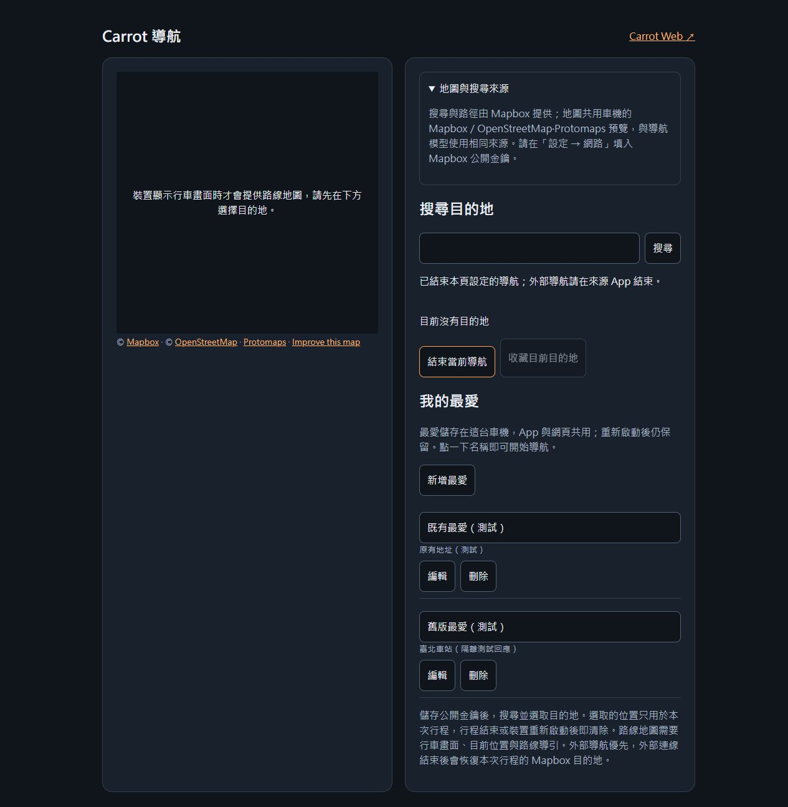

# Mapbox 與 OpenStreetMap 導航

2026-11-17 起，網頁、CarrotAssist APK 與 Carrot Cockpit 的導航頁共用原有 Mapbox／OpenStreetMap·Protomaps 流程，移除 Google Maps／Places 顯示、搜尋及瀏覽器金鑰入口。

| 功能 | 使用來源 |
| --- | --- |
| 目的地與最愛地址搜尋 | Mapbox Geocoding |
| 路徑規劃、轉彎指引 | 原有 Mapbox 導航；外部導航的優先順序保留 |
| 車機、網頁、APK 顯示的導航地圖 | 共用 mapsd 的 Mapbox／OpenStreetMap·Protomaps 預覽 |
| 導航模型圖資 | 同一個既有 mapsd 流程，不另算第二條路線 |

「OpenMap」在此指 OpenStreetMap。來源依車機原有配置決定：設定了 Mapbox 公開金鑰時 mapsd 使用 Mapbox 圖磚；沒有該金鑰時，沿用既有託管 PMTiles／OpenStreetMap·Protomaps 資料來源。這不是獨立的OSM搜尋服務，也沒有新增對公共OSM圖磚或Nominatim的請求。Mapbox搜尋及內建路徑規劃仍需要原有金鑰；OSM底圖不會代替Mapbox路徑API。

## 使用方式

1. 停車後更新並重新啟動 `carrot-wip` 車機，重新開啟網頁或APK。此項為車機網頁與後端更新，CarrotAssist及Cockpit原生APK不需重新安裝；Cockpit沿用0.4.0。
2. 在「設定 → 網路」填入原有 Mapbox 公開金鑰。金鑰由車機用於搜尋及路線服務，不放在公開APK或README。
3. 開啟「導航地圖／Navigation」，按「地圖與搜尋來源」可查看分工。輸入目的地後按「搜尋」或Enter，選取結果即可設定本次行程目的地。
4. 路線預覽仍需要有效位置、路線導引及車機行車畫面；停車時可以搜尋、管理最愛及選定目的地，但地圖可能顯示等待提示。失去位置、路線或連線時清除舊圖，保留Mapbox、OpenStreetMap及Protomaps來源標示。
5. 「結束當前導航」清除此頁設定的目的地；外部導航仍需在來源App結束。

搜尋仍只在明確送出時執行，保留頻率限制、逾時及錯誤提示。儲存地址沿用Mapbox永久地理編碼，須帳號支援且依Mapbox費率計費；僅改名不需重新搜尋。沒有共用Google金鑰或Google SDK載入。

## 最愛與舊版資料

- 既有Mapbox最愛保留名稱與座標，新增、改名、替換地址、刪除及點名稱導航均沿用原有流程。刪除仍需第二次確認。
- 舊Google最愛只有地點ID及使用者命名，沒有儲存可直接導航的座標。名稱與ID保留，畫面會標示「舊版最愛 · 需重新選定地址」。
- 點該名稱或「編輯」，用Mapbox重新搜尋並選取地址，確認名稱後儲存；原有最愛ID及名稱保留，再點名稱即可導航。只改名仍可儲存，但開始導航前需先完成選址。系統不會自動猜測地址或把舊ID轉成任意座標。
- Google金鑰不再出現在客戶端設定規格及導航API回應；舊Google來源設定自動正規化為Mapbox。這次軟體更新不會刪除Google Cloud專案、帳單帳戶或雲端金鑰。

## 驗證範圍

10項相關前端測試與23項後端測試通過。完整網頁989項中987通過，另2項仍為既有投影浮點末位及Vision測試缺少相依函式。

瀏覽器以隔離後端及模擬Mapbox搜尋回應驗證：來源繁中說明、舊最愛重新選址、保留名稱、儲存、點名稱設定目的地與結束導航。未使用使用者的金鑰、位置或行車資料，未宣稱已完成實車圖磚／路線驗收。mapsd、導航模型及車輛控制程式未修改。

