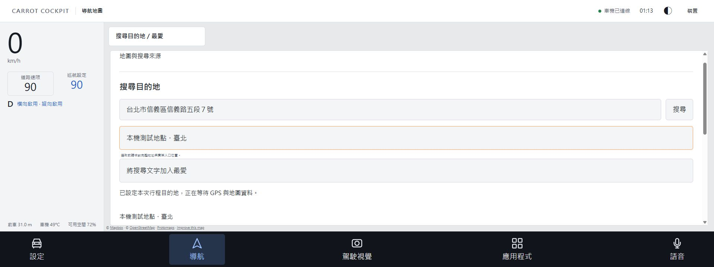

# Mapbox 與 OpenStreetMap 導航

網頁、CarrotAssist APK 與 Formosa 座艙的觀看地圖使用 **OpenStreetMap（OSM）**；搜尋、路徑規劃及模型圖資保留既有 Mapbox 流程。最愛只儲存名稱與輸入的地址文字，要導航時才一般查詢；停用永久地理編碼。

| 功能 | 來源與處理方式 |
| --- | --- |
| 新增／命名／編輯最愛 | 車機本機儲存使用者輸入文字，不呼叫地理編碼 API |
| 導航前搜尋位置 | Mapbox 一般（Temporary）Geocoding，明確送出後才查詢 |
| 路徑規劃、轉彎指引 | 原有 Mapbox 導航，保留外部導航優先順序 |
| 網頁、APK 觀看地圖 | OSM 底圖，疊上車機目前的同一份 navRoute、位置與有效轉彎指引 |
| 車機模型圖資／原生地圖 | 保留 mapsd 的 Mapbox／OpenStreetMap·Protomaps 流程 |
| 導航模型圖資 | 沿用既有 mapsd 流程，不另算第二條路線 |

「OpenMap」在此指 OpenStreetMap。模型端有 Mapbox 公開金鑰時仍用 Mapbox 圖磚，未設定時保留原託管 PMTiles 來源；不將瀏覽器的 OSM 畫面送入模型。觀看端以 Leaflet 顯示 OSM 圖磚，只讀取 tmpfs 的路線副本，不另算第二條路線，也不使用 Nominatim 搜尋。

## 使用方式

1. 停車後更新並重新啟動 carrot-wip 車機，重新開啟網頁或 APK。Formosa 座艙沿用 0.6.0，CarrotAssist 沿用既有 APK，不需重裝。
2. 在「設定 → 網路」填入原有 Mapbox 公開金鑰。沿用車機既有服務，不把金鑰包進公開 APK 或 README。
3. 開啟「導航地圖／Navigation」，輸入完整地址後按「搜尋」或 Enter。唯一且高信心的完整地址直接開始導航；多筆、道路／區域或近似結果仍列出供選擇，避免自動帶往同名地點。
4. 「地圖與搜尋來源」可選台灣／全球。繁中裝置預設台灣，使用 country=tw、language=zh-Hant，全形數字會轉成一般數字再查詢；不改寫門牌或猜測路口。
5. 搜尋會列出可用的精確度資訊；道路、區域或近似結果會提醒再次核對。請確認完整地址及實際入口。這些改善不代表結果保證與 Google Maps 一樣準確。
6. 停車也可觀看 OSM 底圖及選定目的地；實際位置、路線及轉彎／剩餘距離卡片須車機提供有效資料。過期會移除舊路線、位置及指引，不把舊圖當成目前狀態。拖曳可瀏覽地圖，「回到目前位置」恢復跟隨。
7. 「結束當前導航」清除本頁設定的行程目的地；外部導航請在來源 App 結束。

## 最愛地址

- 按「新增最愛」，填入名稱及地址／搜尋文字後儲存。新增、編輯、改名都不發出位置查詢，也不儲存一般查詢回傳的座標、地點 ID 或格式化地址。
- 點最愛名稱時才查詢，符合唯一高信心完整地址時直接開始，其餘選定結果後開始。不會直接送出舊座標。
- 「收藏目前搜尋文字」及結果旁的收藏只儲存你原先輸入的文字。暫存搜尋結果與本次目的地不會寫入最愛檔案；結束行程或重新啟動後清除本次目的地。
- 刪除仍需第二次確認，原有名稱、ID、檔案原子寫入及驗證保留。
- 既有 Mapbox 最愛不刪除，名稱與舊資料仍可讀取；啟動導航改為重新搜尋及確認可用結果。編輯可轉存為文字最愛，不再購買永久地理編碼。
- 舊 Google 最愛保留名稱及地點 ID；缺少可搜尋文字時請編輯填入地址。系統不會把舊 ID 猜成任意座標。

## 費用與限制

觀看端使用 OSM 公共標準圖磚，保留可見署名、正常瀏覽器快取及 Referer，只載入正在觀看的範圍，不提供預載或離線下載。OSM 公共服務沒有可用性保證；大量用戶部署需改用合適的 OSM 服務商或自架服務，不能當作無限免費商用 CDN。依 [OSM 圖磚使用政策](https://operations.osmfoundation.org/policies/tiles/)。搜尋及模型仍使用 Mapbox，因此不是所有導航服務都免計費。

已移除永久查詢入口，後端也會拒絕 permanent=true，避免舊頁面誤用。一般查詢仍保留頻率限制、逾時及錯誤提示，輸入每個字不會自動查詢。

一般查詢有 Mapbox 帳戶的免費額度，**超出仍可能計費**；圖磚、路徑規劃及其他 API 也可能分別計費。本次不會替帳戶設定硬性費用上限。以 [Mapbox 費率](https://www.mapbox.com/pricing)及[地理編碼文件](https://docs.mapbox.com/api/search/geocoding/)為準；更新不會退回既有帳單費用。

不再載入 Google Maps／Places SDK 或顯示 Google 金鑰；舊來源設定正規化為 Mapbox。本次不會刪除 Google Cloud 專案、帳單或雲端金鑰。

## 驗證範圍

已用隔離後端及模擬回應驗證既有最愛、一般查詢、唯一高信心地址自動開始、模糊結果待選、導航狀態同步、結束及失敗回讀。另檢查只讀 OSM 路線、隱藏暫停、失效清除、拖曳後停止跟隨，以及指引卡片隨有效資料更新。mapsd 只新增輸出有效指引至 UI 副本，模型圖像、路徑規劃與車輛控制未改。尚未實測台灣地址命中率或實車新路線；模擬圖磚不是實際 OSM 圖資品質驗收。

