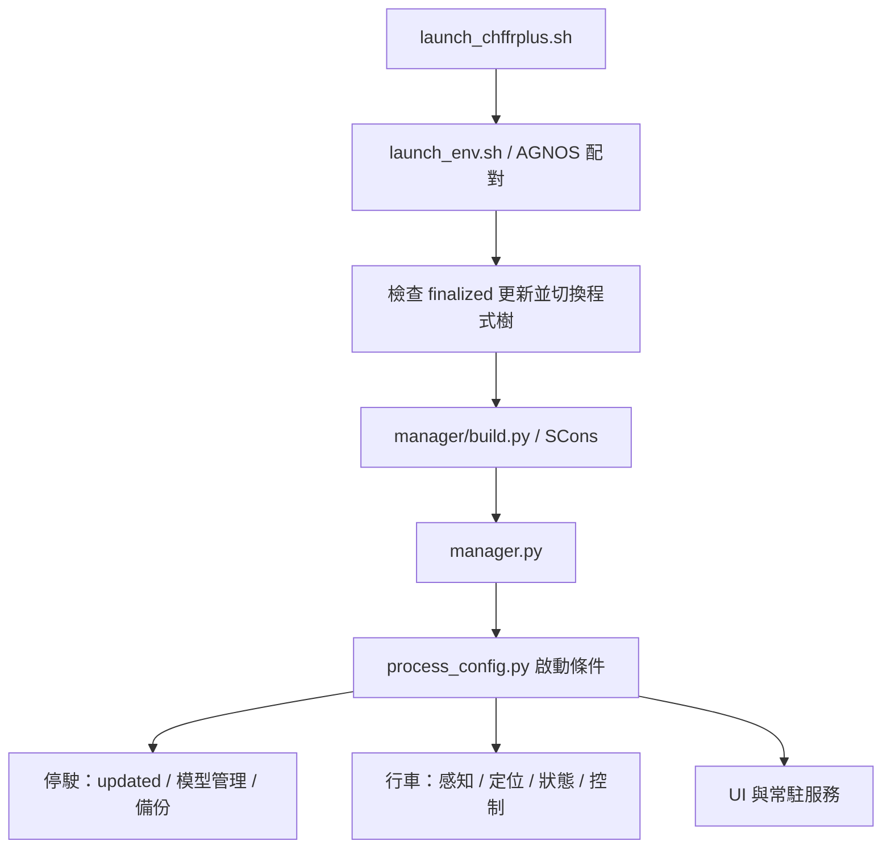
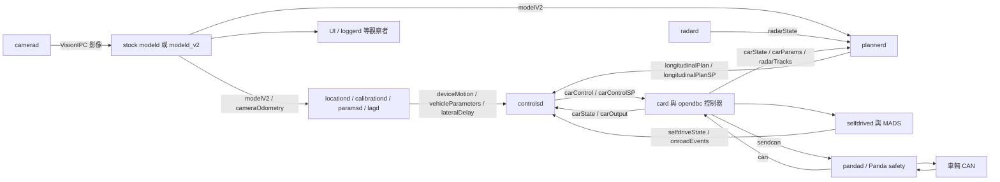

# 目前架構與資料流

分析提交、版本及導覽見 [入口文件](README.md)。下述「現況」由程式與子模組釘選核對；「建議」表示後續可採取的維護方式。

## 一個共用底層，三個獨立維護維度

兩分支沿用 openpilot 的多程序架構，在 `openpilot/sunnypilot/` 加入擴充，也直接修改部分上游檔案；不能只更新該目錄就完成整個 fork 的升級。

| 維度 | 現有選項 | 維護意義 |
| --- | --- | --- |
| 車種／產品分支 | hkg-enhanced、ccnc-port | 控制器、opendbc、功能與支援政策不同 |
| 裝置 | C3X（tizi）、C4（mici） | AGNOS、相機、UI 配置與裝置驗證分開處理 |
| 模型執行 | stock modeld、sunnypilot modeld_v2；QCOM／Chestnut | 模型 runner 與推論後端是不同的選擇 |

現有 `GuiApplication.big_ui()` 對 tici／tizi 使用大型介面，mici 使用小型介面，PC 測試也可用 `BIG` 覆寫。不要把大型／小型介面名稱當成硬體辨識的唯一來源。

Chestnut／eGPU 的選擇還依 USB、模型是否可用與執行狀態決定。**程式沒有把 C3X 固定成 QCOM，也沒有把 C4 固定成 eGPU。** 持續維護 C3X，必須同時保留硬體適配與該裝置可執行的模型路徑。

## 啟動與程序管理

`manager.py` 依 `deviceState.started`、Panda 點火訊號及 `CarParams` 管理程序；`process_config.py` 定義何時執行。參數會在 manager 啟動、行車／停駛轉換或點火時依旗標清除，參數儲存生命週期是模組介面的一部分。

根目錄的 `system/` 等路徑含相容入口。AGNOS manifest 目前位於 `openpilot/common/hardware/comma/agnos.json`，啟動器仍使用相容路徑；升級時要確認它們指向同一內容。HKG 額外有獨立開機／UI 當機診斷，CCNC 尚未包含同一套診斷檔案。

## 行車主資料流

這是主要關係的簡圖，沒有列出所有發布者與訂閱者。駕駛監控另有 `dmonitoringmodeld` → `dmonitoringd` → `driverMonitoringState`，供 `selfdrived` 與 UI 使用。

`selfdrived` 管理啟用、退出與警示；MADS 擴充橫向／縱向狀態規則；`plannerd` 產生縱向計畫及輔助資訊；`controlsd` 將模型、計畫與車況轉成致動命令；`card` 執行車型介面與 CAN 打包。它們不是可任意互換的同一層控制器。

## 通訊與設定介面

| 介面 | 程式位置 | 修改時的連帶責任 |
| --- | --- | --- |
| 訊息 schema | `openpilot/cereal/log.capnp`、`custom.capnp`、opendbc structs | 欄位 ordinal／型別、發布與訂閱端、舊紀錄遷移 |
| 訊息服務 | `openpilot/cereal/services.py`、messaging、`msgq_repo` | 頻率、有效性、佇列、訂閱唯一性、重播 |
| 影像傳輸 | msgq VisionIPC、cereal VisionStreamType | 串流識別、大小、格式、消費端對應 |
| 持久設定 | `openpilot/common/params_keys.h`、Params、params migration | 型別、預設、清除時機、備份與 sunnylink |
| 車型能力 | opendbc `CarParams`／`CarParamsSP`、sunnylink capabilities | UI 能力判斷與初始化採同一規則 |

HKG 曾修正 GPS 重複訂閱與頻率／時間停滯問題；該 messaging 與 realtime 修正不全在 CCNC 分支。移植通訊層時，要保留正常頻率、異常恢復與原有健康檢查，不能以停用檢查處理相容性。

## 模型管理與推論分成兩個部件

`models/fetcher.py`／`manager.py` 處理目錄、下載、雜湊、快取與 QCOM／Chestnut 的選擇；`modeld_v2` 處理編譯、模型格式、adapter、影像 warp、載入與推論。`get_active_model_runner()` 配合程序啟動條件，選擇 stock runner 或 tinygrad runner。

目前 QCOM 目錄使用 v25、Chestnut 使用 v28，selector 相容版本為 21。這些是快照數值，未來須以 `models/fetcher.py`、`models/helpers.py` 為準。模型檔來源、SHA-256、輸入輸出 shape／dtype、tinygrad API、後端與 AGNOS 必須一併記錄。plain artifact 的編譯器 revision 與裝置 runtime revision 可以不同；相容性仍須由實際模型載入、CPU contract 及裝置測試證明。

## 車種與 safety 必須成組維護

`card.py` 先透過 sunnypilot `initialize_params()` 傳入設定，再由 opendbc `get_car()` 建立車型介面、控制器及 Panda safety 參數。HKG 低速扭力的 UI 開關不會直接修改控制迴圈；它須在初始化時同步配置控制器與 safety。

| 邊界 | hkg-enhanced | ccnc-port |
| --- | --- | --- |
| opendbc | `1c51731784729da5ebaf24b3c34106bd27aaf94b` | `23330cb5ab3ff9668421603dac22a4e98060b67c` |
| Python 動態扭力旗標 | `2**27` | `2**28` |
| Panda 動態扭力旗標 | `1024` | `2048` |
| CCNC 旗標 | 不採右欄定義 | Python `2**27`、Panda `1024` |

相同數值在兩分支代表不同含義。不可只移植旗標數值、控制器、UI 或 safety 其中之一。Panda 儲存庫釘選相同也不代表安全行為相同：其建置還包含各分支釘選的 opendbc safety 來源。

CCNC 分支的維護政策限定 CCNC，仍保留跨品牌的 opendbc／card 架構；本次未找到主程式統一拒絕非 CCNC 平台的入口。因此「僅支援 CCNC」目前應理解為維護與驗證政策，不能直接視為執行時的白名單。HKG 分支則保留跨品牌結構與 HKG 實驗功能；具體支援承諾仍由維護者的車型清單決定。

## 導航與地圖輔助是不同系統

| 系統 | 現況 | 主要用途 |
| --- | --- | --- |
| `selfdrive/navigation` 的 navd／mapsd | 兩分支均有；行車時依 NavigationEnabled 啟動 | 路線、導航指示與地圖影像 |
| sunnypilot mapd／限速／智慧巡航 | 兩分支皆有 | 道路資料、限速與規劃輔助 |
| 導航資料送入駕駛模型 | 目前兩分支 runner 未接上 nav_map／navigation_input | 後續導航模型整合工作 |

`mapsd` 與 `mapd` 不是同一程序。HKG 已可發布 `navRoute`、`navInstruction` 與地圖影像，不等於駕駛模型已按導航路線行駛。nav-model-integration 應作獨立升級項目，需同時處理訊息、renderer、模型輸入、模型產物與兩種 runner。

## 兩分支功能差異

| 部分 | 共用主體 | 目前差異 |
| --- | --- | --- |
| 硬體／建置 | AGNOS 20.1 目標、C3X／C4、SCons | HKG 多一套開機與校正畫面診斷 |
| 模型 | tinygrad pin、下載／plain artifact／主要 runner | CCNC 的相機偏移 helper 納入俯仰校正；測試集合也不同 |
| 控制擴充 | MADS、NNLC 等擴充框架 | HKG 保留 DEC，另加入預設關閉的 Honda／Toyota 低速扭力控制調校；CCNC 未加入這項車種調校，且已移除 DEC 與相關介面 |
| 車型／儀表 | card、opendbc、Panda 邊界 | CCNC 增加車型／訊息及儀表整合，並有獨立旗標配置 |
| UI | 大型與 mici 兩條介面 | HKG 藍色路徑／停車標記／字型與 CCNC 翻譯機制有差異 |
| 雲端 | athena、sunnylink、備份 | HKG 額外含遠端更新請求處理 |
| 發行 | 版本、中文 CHANGELOG、更新畫面、共同 CI | 部分歷史工作與 QA PR 的輔助工作不同 |

「共用」表示共同維護邊界，不保證所有檔案逐位元相同。同步修正前仍需查看實際 diff。

## 子模組釘選

| 路徑 | hkg-enhanced | ccnc-port |
| --- | --- | --- |
| opendbc_repo | `1c51731784729da5ebaf24b3c34106bd27aaf94b` | `23330cb5ab3ff9668421603dac22a4e98060b67c` |
| panda | `4230530f5ec4c7f11971f868ae9930b3547346eb` | 相同 |
| tinygrad_repo | `92b742f711c7d216fd3ed7a46a30a959e3c43bd4` | 相同 |
| msgq_repo | `e7396e76dadbb49e374d4b664ff6bbb43a39bcb0` | 相同 |
| rednose_repo | `28d4a7f69e80e1c3e0d24ca0733d7daeaeade3d0` | 相同 |
| teleoprtc_repo | `1aa8fc433bef1519a95c0700c96258c3be6dfb34` | 相同 |
| openpilot/sunnypilot/neural_network_data | `03cac2d30e111e0689c0429cb8c1fe6cb5a905af` | 相同 |

`.gitmodules` 記錄來源 URL，gitlink 記錄實際版本。更新遠端分支不會自動改變這些固定提交；升級紀錄必須同時記錄程式提交與子模組提交。
