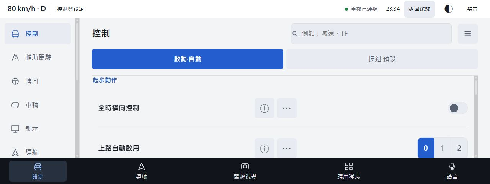
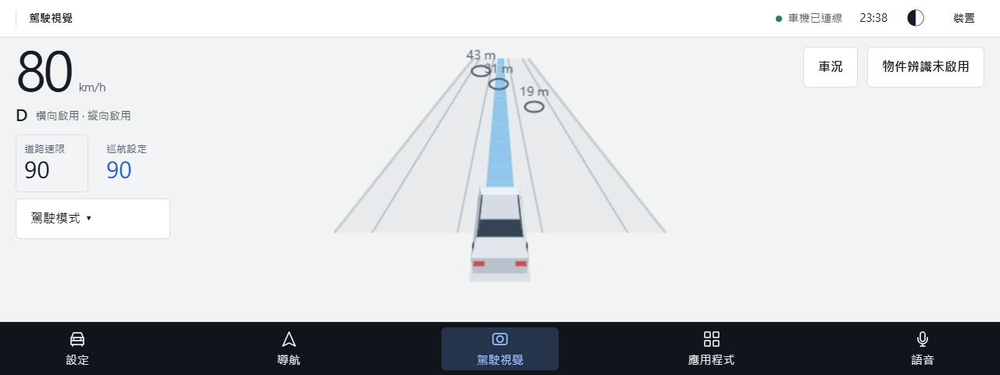
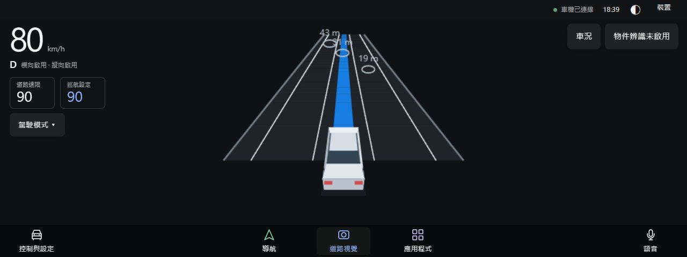
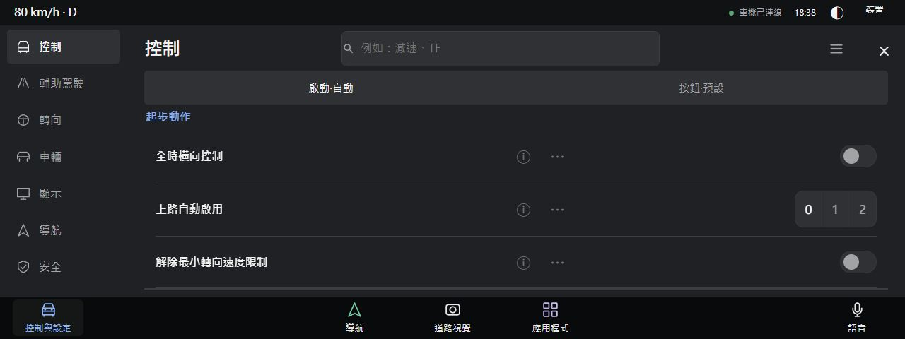
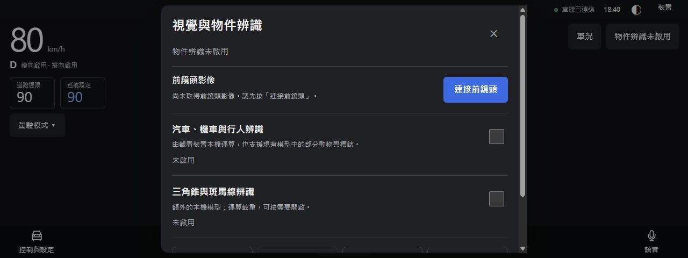
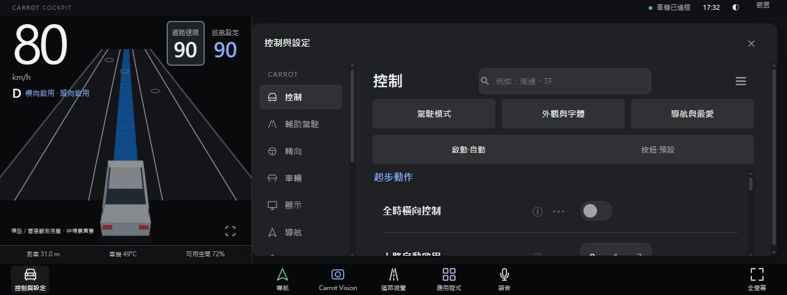
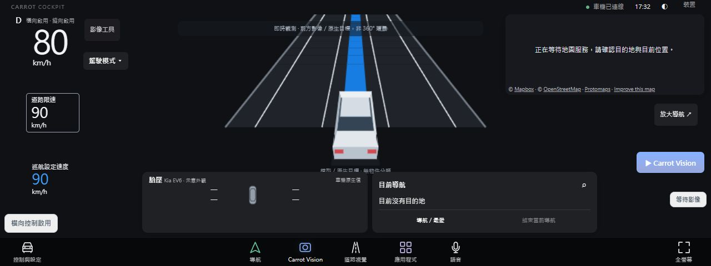
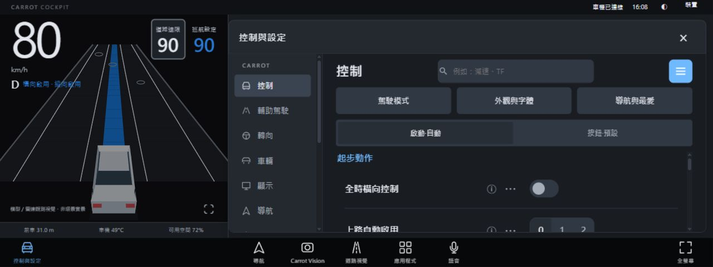
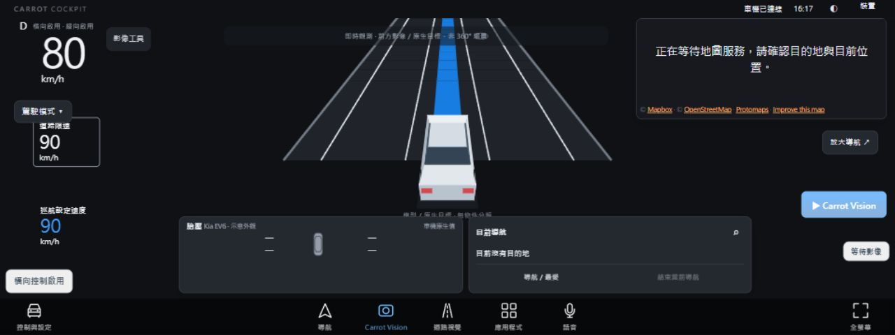

# Formosa 座艙 繁中 0.6.0

獨立的 Android 座艙版，套件 `me.shind0.carrotweb.tw.cockpit`，可與 CarrotAssist 繁中並存。Android 8.0 以上；本版依使用者要求移除語音功能與麥克風權限，原 CarrotAssist 保留語音。介面參考中央觸控螢幕的車況／導航分割、底部快捷列與模式卡片，沿用 Carrot 現有功能，車輛及圖示使用本專案原創繪圖，沒有 Tesla 程式、標誌或車輛模型。

[下載 APK](https://github.com/TonyBinheWu/sunnypilot/releases/download/carrot-cockpit-tw-v0.6.0/CarrotCockpit-TW-0.6.0.apk)

先更新並重新啟動 TonyBinheWu/sunnypilot 的 carrot-wip 車機，再讓 Android 裝置與車機連上同一 Wi-Fi／熱點。首次開啟重新選擇裝置；獨立套件的連線資料與授權分開保存，原版資料不會被匯入或覆寫。尚未支援遠端 FormosaLink 在這個 LAN 版本中直接啟動座艙。

## 介面與操作修正（2026-11-18）

本車外觀增加 Kia／Hyundai 車款示意、九種可儲存車色，以及以本車為中心的旋轉與縮放；車機回報的煞車燈、方向燈解除後即清除。一般網頁與座艙共用。操作位置、支援清單與限制見[本車外觀與車色指南](VEHICLE_DISPLAY.zh-TW.md)。

已補強頂部狀態列、4:3 設定空間、大字車況卡片、固定彈窗標題、逐層返回、載入重試與既有導航同步；結束導航會回報真正結果，行駛時取消待確認模式。現有 0.6.0 APK 可沿用，更新並重啟車機後重新開啟 App。參閱[完整問題清單、截圖與測試範圍](INTERFACE_AUDIT.zh-TW.md)。

## 安卓手機主要顯示

手機首頁使用較清爽的單欄清單，小尺寸減少常駐捷徑與重複狀態。支援手機直向／橫向自適應、滿版 3D、完整寬度的設定與導航、長標題換行、200% 大字及獨立底列。修正搜尋關閉後重啟鍵盤，Android 返回鍵可先收起搜尋。直向畫質預算跟隨長邊，避免本車過大或畫面過度縮小。[手機操作與實測範圍](PHONE_DISPLAY.zh-TW.md)。現有 0.6.0 APK 可沿用，更新車機後重新開啟即可。

## Formosa 座艙 0.6.0

依使用者要求移除座艙版語音入口、浮動麥克風、自動聆聽、中文語音設定與麥克風權限；原 CarrotAssist 保留語音。頂部使用台灣時區顯示完整日期及即時秒數；橫向／縱向以各自新鮮 carControl 狀態顯示介入中／未介入／無資料，並不以總開關代替控制狀態。左側車模採獨立空間，不與讀值疊畫。

座艙版改名「Formosa 座艙」，採獨立藍色中控螢幕圖示；原 CarrotAssist 名稱、圖示及套件不變。沿用座艙套件 me.shind0.carrotweb.tw.cockpit 與原簽章，因此可覆蓋更新而保留既有資料。版本 0.6.0／code 8 需要車機網頁 layoutVersion 7；先更新 carrot-wip 車機。

控制與設定改為中央觸控螢幕的分區操作：寬螢幕左側保留車況，右側控制頁先顯示駕駛模式、鏡頭辨識、車況、顯示、連線及診斷六個常用入口；完整參數仍保留在分類及搜尋。寬螢幕底部提供設定、導航、駕駛視覺、應用程式、紀錄與聲音六個入口；手機直向與低高度小視窗使用四個主要入口，紀錄與聲音集中至應用程式。停車模式不在本車圖上重複堆疊車速／限速；較窄的 4:3、直向頁面改為完整設定面板。

功能只沿用現有能力，不提供沒有實作的 Tesla 空調、車門、排檔或 FSD 控制。繁中說明、詳細指南、確認、權限、回讀及原生連線復原保留。已以 USB ADB、Samsung SM-A146P／Android 14 安裝實測；車況與校正為隔離合成資料，另使用真實公開影片執行原辨識模型，不連線實車。詳見 [0.6.0 驗收與限制](FORMOSA_COCKPIT_0.6.0_ACCEPTANCE.zh-TW.md)。

### 滿版 3D 駕駛視覺

道路場景鋪滿可用螢幕，檔位、速度、速限、巡航設定、控制狀態、日期時間及固定底列浮在場景上。使用 WebGL 2 立體模型與光照：汽車、巴士、卡車、行人、機車、腳踏車、三角錐及既有模型支援的九種動物均有原創 3D 外觀；未分類原生目標以中性立體框表示。保留依車速縮放、拖曳旋轉、視角回正、彩虹路徑、本車車型外觀與實際燈號。

交通號誌、STOP、鳥類、斑馬線等只有影像觀測而無有效距離的結果，以 **3D 觀測圖示** 顯示並標明「未提供 3D 位置」，不放入道路世界、不猜測紅綠燈色。停止線及機車停等區仍沒有可用辨識模型；本次不新增偵測類別、VIO、3D 地圖或車輛控制。前鏡頭無法提供完整環車覆蓋；道路僅繪製現有模型的車道／路徑資料，沒有假造建築、樹木、其他車輛或 Tesla FSD 狀態。

低規或不支援 WebGL 2 的裝置保留原有投影幾何備援。繪圖 context 遺失時暫用備援，恢復後重建 3D 資源；分類與過期規則沿用原辨識流程。切換 BEV、工具、導航或背景頁面保留原生命週期管理。大字模式的頂列／底列採有限放大，1920×720 保留左側車況；4:3 的設定／工具／紀錄改用完整寬度。

[操作概念參考 Tesla Touchscreen](https://www.tesla.com/ownersmanual/modely/en_us/GUID-518C51C1-E9AC-4A68-AE12-07F4FF8C881E.html)。本 App 為 Formosa 分支座艙，並非 Tesla 原廠軟體。

## 2026-11-18：1920×720 自適應、視角與本車燈號

車機更新後，0.5.0 APK 及網頁會使用新版畫面，不需重新安裝 APK。12.3 吋以使用者確認的 **1920×720** 為主要尺寸；另支援 4:3 與 Android 密度 2 時的 960×360 邏輯尺寸。短螢幕使用並列儀表，避免大字遮住速限、駕駛模式及底列。

- 駕駛視覺隨速度平順縮放：低速靠近，高速拉遠，本車靠近畫面下方以減少空白。過期資料、背景頁面及凍結畫面不會觸發縮放；BEV 的手動範圍維持原樣。
- 拖曳道路畫面可左右旋轉、上下調整角度；「視角回正」回到前方。方向鍵也可調整、Home 回正。切換設定／導航或進出全螢幕會保留角度，重新開啟頁面才重設。旋轉不會產生前鏡頭看不到的環車物件。
- 本車依實際辨識車型選擇 EV6、Sorento、Sportage、Carnival、EV9 外觀；保留既有 IONIQ 5／Model 3／Model Y／通用外觀，未識別車型使用通用模型。五款 Kia 分別調整車身比例、車頂、玻璃、輪圈、側鏡與尾燈，屬原創示意模型，並非 Kia／Tesla 原廠儀表資產或精確 CAD。
- 車況的 brakeLights 訊號亮起時，本車尾燈及高位煞車燈變亮；包含車型有回報的再生煞車啟燈。沒有訊號時不從減速猜測。左／右方向燈跟隨車況開關，雙黃燈兩側一起閃；畫面採固定節奏，不保證與實車每個閃爍週期同相位。資料過期即清除，不套用到其他偵測物件。
- [導航最愛](../../docs/NAVIGATION_MAPBOX_OSM.zh-TW.md)改存名稱及自行輸入的地址文字，新增／編輯不查詢；導航前才一般查詢並選擇位置，已停用永久地理編碼。一般查詢超出免費額度仍可能計費。

[完整驗收紀錄與限制](COCKPIT_0.5.0_ACCEPTANCE.zh-TW.md)。本次未改動轉向、巡航、Panda 或實車設定。

## 0.5.0 車載介面重新編排

先停車，更新並重新啟動 `carrot-wip` 車機，再覆蓋安裝 **0.5.0（versionCode 7）**。介面由車機提供，APK 檢查 `layoutVersion≥6`；只換 APK 不會更新車機網頁。套件、簽章與更新來源延續，原有設定不重設，原版 CarrotAssist 保持獨立。

- **一次處理一項操作**：固定狀態列顯示目前頁面、車速／檔位與連線；底列固定在可用視窗底部，設定、導航、駕駛視覺、應用程式與語音各有單一入口。設定與工具使用完整寬度，按「返回駕駛／返回導航」回到先前主畫面。
- **扁平化與清楚層級**：中性色平面、清晰分隔線、少量藍色表示選取，減少陰影與常駐卡片。設定列一般18px、Full HD 23px；主要按鈕52–56px起，部分說明按鈕在中型畫面48px。文字可換行，不靠縮放整頁塞入畫面。
- **分類與內容分開捲動**：設定取消常駐重複快捷卡。寬畫面保留側欄，800px以下改為「分類」抽屜，選擇後自動收合；遮罩或 Escape 可關閉。各分類記住本次開啟後的分頁，快速切換時舊請求不能蓋掉新選擇。
- **繁中搜尋與詳細指南**：原有搜尋、輸入、確認、驗證、回讀、收藏、設定檔、熱門值與修改歷史完整沿用。「ⓘ」展開說明與還原，「⋯」開詳細指南。資訊按需展開，未刪除原始說明。
- **分組應用程式**：「駕駛與車況」集中車況／胎壓、鏡頭與物件辨識、駕駛模式、導航與行車紀錄；「設定與服務」集中工具／診斷、全部設定、顯示／字體、全螢幕與裝置更新。導航搜尋／最愛同步加大欄位與操作列。
- **大字模式修正**：避免以自訂變數定義的字體再次被共用縮放器放大，200%設定文字實測36px，沒有變成72px。狀態列、底列及搜尋／分類標頭採有限放大，保留主要閱讀區；內容仍可依原有80–200%設定放大、捲動。淺色與深色選取對比一併調整；導航子頁同步目前字級，不再保留前次的大字。

工具頁通知改為按需展開，仍沿用通知／錯誤狀態與內容；不再常駐占用空白側欄。工具內的導航入口直接回到座艙導航。

八種可用尺寸實測：1280×480、1920×1080、1600×900、1280×720、960×540、1024×768、800×600、390×844。確認底列貼底、設定與外層無橫向溢出；另測200%大字、繁中搜尋及詳細說明。資料來自本機隔離合成車況，沒有連上或修改實車。這是車載座艙介面，不會取代 Android 作業系統；實體車用盒子與觸控實測仍待完成。原始量測見 [版面記錄 JSON](testing/cockpit-os-0.5.0-layout.json)。

驗證：43項座艙測試與2項頁面HTTP測試通過；完整網頁999項中997通過，另2項為既有投影浮點數末位與 Vision fixture 缺少 `isCarrotVisionParked`。隔離資料實測語音播報音量100→101→100並回讀，繁中搜尋、功能說明、詳細指南、分類、應用程式、通知與導航入口可用。導航字級200%→100%無需重載，實際欄位36px→18px。沒有測試真實地圖API、鏡頭、Android觸控或實車連線穩定性。

原生CI [44117337061](https://github.com/TonyBinheWu/sunnypilot/actions/runs/44117337061)編譯、原生檢查與v2／v3簽章驗證通過；APK來源 `edd8c005470be3a346a2506ff7e46f7305750ded`。另獨立核對ZIP CRC、DEX版面檢查、SHA-256與既有v2簽章憑證一致，公開免登入下載與座艙更新來源均已驗證。0.5.0 APK SHA-256：`d5739ffae92087b8821f3d710bfca6ed39f9884124f268892ffccf93ebdc4941`。原有已發布APK保持不變。

以下為瀏覽器合成資料預覽：

導航現已統一使用[Mapbox／OpenStreetMap](../../docs/NAVIGATION_MAPBOX_OSM.zh-TW.md)，移除Google圖層、搜尋與金鑰入口；舊最愛保留名稱並可重新選址。新版座艙介面請依上方0.5.0步驟更新。

## 0.4.0 短螢幕操作與物件辨識引導

已補上[真實影片、16:9與4:3驗證記錄](COCKPIT_VALIDATION.zh-TW.md)：行人、汽車、機車均取得動態分類與立體圖形；設定／導航返回及實際進出全螢幕後持續更新。支援六種可用尺寸，Full HD自動放大操作尺寸，並修正舊樣式將設定文字壓小的問題。辨識頁可查看各類可定位數量。此項為車機網頁更新，APK沿用0.4.0；尚未完成實體Android／車用盒子驗收。

**先停車，更新並重新啟動 carrot-wip 車機，再覆蓋安裝 0.4.0（versionCode 6）。** 套件及簽章延續，不必移除 App 或清除設定。車機提供新版網頁功能，APK 檢查提升為 layoutVersion≥5；只更新 APK 不會取得新的車機功能。

- 控制與設定、工具及行車紀錄使用完整寬度。設定去除重複標題與快捷卡，保留分類、分頁、搜尋、原始輸入及所有確認；分類與設定各自捲動。主要操作至少48像素，設定列文字加大，按「ⓘ」展開完整繁中說明；「⋯」仍可開詳細指南、熱門值與修改歷史。
- 道路主畫面使用集中車速／檔位／道路速限／巡航設定，減少重複儀表與常駐文字。胎壓、導航狀態與結束當前導航移到右上「車況」。沒有目的地或地圖影像時隱藏空白小地圖；導航頁與最愛完整保留。
- 底列保留控制與設定、導航、道路視覺、應用程式、語音五項。其餘車況、駕駛模式、道路視覺捷徑、全螢幕、行車紀錄、工具／診斷、顯示／字體、裝置與 App 更新集中在應用程式。既有自訂儀表位置、大小及進階影像工具可從視覺設定重新開啟，偏好不被重設。
- 修正只顯示3D道路、尚未啟動相機時可能漏訂閱 `modelV2`／`radarState`／校正資料的缺口。可見座艙取得單一 HUD／overlay 訂閱，離開、暫停、背景、回放或更換頁面時釋放；不會因此啟動相機。未分類原生目標使用較清楚的中性圓圈及距離，不能當成已辨識汽車。
- 修正「道路視覺」捷徑與左側預覽放大會切到另一套僅有模型／雷達的繪圖，導致相機分類物件從畫面消失。所有道路入口現在共用完整 Carrot Vision，保留原有辨識開關、已連接影像及 BEV 偏好；不會因選單入口不同退回只有圓圈的繪圖。有效相機分類的行人、車輛仍使用各自立體圖形；未知雷達目標不會因此被強制改成車輛。此補充為車機網頁修正，0.4.0 APK 原生輸入與已驗證產物相同。

### 看不到其他車輛、機車或行人時

1. 在道路主畫面右上按「物件辨識未啟用」、「連接鏡頭以辨識」或「物件辨識」；也可用應用程式 → 視覺與物件辨識。
2. 按「連接前鏡頭」。沿用原有鏡頭開放與權限檢查，未允許時會顯示原因；只開3D畫面不代表已有相機影像。
3. 開啟「汽車、機車與行人辨識」。三角錐、斑馬線需另開下方的獨立辨識開關。兩者仍預設關閉，寫入經既有設定流程並回讀，不自動重送；影像在觀看裝置本機運算。
4. 查看各模型實際狀態：等待前鏡頭、載入、未支援 WebView、載入／運算失敗、已過期、辨識中但零結果，或已有影像辨識但缺少3D定位資料。影像辨識數量與可定位數量分開顯示；號誌、STOP及斑馬線仍可能只有影像提示。有效車機校正、支援的相機規格及完整影像比例是3D定位的必要條件。
5. 模型失敗可按「重試辨識模型」重新建立已啟用的本機 worker；不改變開關、不自行啟動相機。連線或車機問題可開「車機與影像診斷」，原有停止影像／重試／畫質及自訂儀表在「進階影像工具」。

另一位使用者有物件而本機沒有，可能是相機、上述開關、WebView、模型載入或校正／投影條件不同；畫面會提供當下狀態，不能僅憑照片斷定原因。辨識仍只用於顯示，不影響轉向、巡航或煞停；保留前方視野、未知雷達目標、過期資料清除及既有分類限制。沒有新增環車攝影機或 Tesla 專有感知模型，機車停等區與停止線仍未提供可部署的辨識模型。

驗證：完整網頁990項中988通過；2項既有失敗仍是投影浮點數末位及 Vision 測試缺少 `isCarrotVisionParked`。3項 HTTP／WebSocket 測試通過。新增測試涵蓋單一訂閱及釋放、背景／回放隔離、明確開關與相機操作、模型失敗重試、舊回呼拒收、道路入口共用分類流程，以及新影格行人／車輛分類的立體繪圖與過期清除。1280×480及390×844瀏覽器合成資料確認底列貼底、無橫向溢出、全寬設定、繁中搜尋及說明；測試伺服器嚴格只傳送要求的服務，確認未啟動相機仍訂閱模型／雷達。這些不等於實體 Android 盒子、實車或夜雨辨識驗收。

原生 CI [44067294920](https://github.com/TonyBinheWu/sunnypilot/actions/runs/44067294920) 編譯、原生檢查及 v2／v3 簽章驗證通過。來源 `9c179b55ee61b788b20363adaa98ec9828dd7a72`；APK SHA-256：`a406e93ba24e7497bf09f40153147d3c40f1eb086bb26cfba68b6dffb6e9bf95`。獨立核對 ZIP CRC、DEX 新版檢查及 APK 內 v2 憑證與既有版本一致；公開免登入下載雜湊相符，座艙專用更新來源已指向0.4.0，原版更新來源未改。

以下為合成資料預覽；圓圈為未分類目標，並非實際汽車辨識結果。

## 0.3.1 長時間連線與介面整理

**先更新並重新啟動 carrot-wip 車機，再覆蓋安裝 0.3.1（versionCode 5）。** 套件與簽章延續，不必移除 App 或清除設定。APK 與車機兩邊皆需更新；車機版面檢查提升為 layoutVersion≥4。

- 修正資料通道停住卻未觸發關閉事件時不重連的缺口。外層車況與內層 Vision Compact 通道每5秒使用固定的唯讀心跳，12秒無有效回應即主動捨棄舊通道並重新建立；建立連線超過8秒也會重試。重試間隔由1秒逐步增加，最多15秒。停車時即使沒有行車資料，心跳仍可確認通道存活，並不把空值當成有效車況。
- 原生 App 從背景返回時，不再因單次快速探測失敗而跳回搜尋。真正的頁面載入失敗保留目前裝置，重新驗證同一個區域網路位址後自動載入；失敗持續重試、最長間隔30秒。離開前景、搜尋另一台或結束 App 會取消重試；舊探測結果不能打開另一台裝置。
- 座艙前景顯示期間保持螢幕喚醒，切到背景會解除；不申請背景常駐、電池最佳化豁免或額外 Android 權限。手動鎖屏、盒子休眠及 Wi-Fi 真正斷線仍受系統與網路限制。
- 右上連線狀態可點開，查看重試次數／最近原因，也可立即重建唯讀資料通道。正常重連不重新載入設定頁、不重送設定、巡航、轉向、導航或相機啟動指令；資料仍依原有1.5秒期限過期，回放與背景保護保留。
- 視覺沿用中央觸控螢幕設計語彙，統一中性色表面、藍色重點、數字字距、卡片圓角、分類面板、分段控制與底部快捷列。駕駛模式快捷鍵避開速限儀表；所有功能、繁中搜尋與完整說明保留。屬本專案原創介面，並非 Tesla 軟體。

已通過六小時模擬時間心跳測試、無關閉事件的停滯／重連、取消與背景保護、舊回呼丟棄及實際本機 WebSocket 心跳測試。瀏覽器以合成車況驗證中斷時清空舊速度、恢復後自動繼續，沒有重送設定。這些測試不等於實體 Android 盒子、Wi-Fi 或實車的長時間驗收。

0.3.1 驗證：28項連線／座艙 JS 測試、3項 WebSocket／頁面 HTTP 測試通過；完整網頁983項中981通過，另2項為既有投影浮點數末位及 Vision 測試缺少相依函式。原生 CI [44055120639](https://github.com/TonyBinheWu/sunnypilot/actions/runs/44055120639) 編譯及 v2／v3 簽章驗證通過，憑證與舊版相同。APK SHA-256：`88d35c4ab62818059369bd2cc54b572c591c4df10241c8029f89ccb294e0dcb5`；原生來源 `bed35abf736874be0a5ff8c466b1672bbcc25b5a`。後續版面／說明更新未變更 APK 原生輸入。

以下為桌面瀏覽器合成車況；並非實體 Android／實車驗收。寬螢幕1280×480與直向390×844均核對底列貼齊視窗，繁中搜尋與完整說明可開啟；小地圖依剩餘空間排版，保留來源標示。

## 0.3.0 全景座艙與車型外觀

操作參考使用者提供的 [Tesla Model Y 設定影片](https://www.youtube.com/watch?v=6bPomDyG3A8) 與深色全景截圖，映射至現有 Carrot 功能，沒有取得或使用 Tesla 專有程式與模型。

- 預設進入全寬 Carrot Vision 座艙視覺，深色道路、左側儀表、右上小地圖、下方胎壓／導航浮動卡片、固定底列；已選用 BEV 的偏好仍保留。小地圖的「放大導航」切至完整導航與最愛，底列可回到 Vision。未收到地圖或胎壓時顯示原因／空值，不產生範例資料。
- 左下車輛控制鍵開啟**獨立重排的控制面板**，再按一次或「×」回到先前的 Vision／導航。左側為控制、輔助駕駛、轉向、車輛、顯示、導航、安全、行車紀錄、聲音、服務、軟體與收藏／裝置；右側使用分類分頁、快捷卡、獨立設定列及大型控制。按「ⓘ」展開完整繁中說明、還原與試聽；「⋯」沿用詳細指南／熱門值／修改歷史入口。原始輸入節點、確認、驗證及回讀保留，搜尋仍使用原有繁中／語音搜尋流程；上游新增的未知設定分類也保留在「其他設定」，不會消失。應用程式抽屜提供行車紀錄、工具／診斷、顯示／字體、導航及裝置更新。
- 「駕駛模式」以靠左浮動卡片選擇原有節能／安全／一般／高速。仍先確認、檢查最新 P 檔／靜止／輔助關閉、寫入並回讀；不會將畫面上的模式名稱當成 Tesla 的車輛控制。
- 右上「顯示」或應用程式 → 顯示／字體，可選淺色／深色／自動。舊日夜偏好會保留；自動依觀看裝置時間07:00–17:59使用淺色，其餘時間深色。字體快捷90／100／125／150／200%沿用既有網頁設定與回讀確認，原有工具設定的80–200%範圍仍可使用。未確認時顯示繁中錯誤且不自動重送。
- 開啟座艙時不要求先啟動鏡頭才可看儀表。座艙外層以自己的新鮮 Compact 車況，透過既有 HUD 呈現介面提供時速、巡航、速限、檔位與控制狀態；不寫入控制或相機狀態，回放時停止送入即時儀表。服務超過1.5秒過期即不再提供，HUD最多2秒清除。相同數值的真正資料更新另有750ms保活，沒有資料時不會靠計時器保活。
- 胎壓卡片顯示車機原生回報值，未確認跨車系單位，故不冒稱為 PSI／kPa。0、非數字、無資料與過期值顯示「—」。結束導航按鈕沿用導航頁原有流程，外部導航須在來源 App 結束；沒有目的地時按鈕停用。

### 本車自動皮膚

網頁與 APK 的立體視覺／BEV，以及座艙停車示意車輛，使用同一套原創輪廓。每30秒最多讀取一次既有 `/api/params_bulk?names=CarName,CarSelected3`，優先用實際辨識的 CarName，無有效值才用手動選車 CarSelected3。**只讀取，不修改車型、不載入參數文字指定的網路模型。** 顯示設定會列出來源車型與所選示意外觀。

| 車系 | 目前外觀 |
| --- | --- |
| Kia EV6 | 低車頂跨界輪廓 |
| Hyundai IONIQ 5 | 方正掀背輪廓 |
| Kia Sorento | 長車身、高車頂休旅輪廓 |
| Tesla Model 3／Model Y | 分別使用轎車／跨界示意輪廓 |
| Toyota RAV4、Honda CR-V、Hyundai Tucson、Kia Sportage | 通用休旅輪廓 |
| 未知或未列車型 | 通用轎車示意，不把未知車型猜成 EV6 |

這些是車系辨識後的**示意皮膚**，不是原廠 CAD、真實車色、精確車身尺寸或 Tesla 感知模型。周圍目標仍按實際辨識類別繪製，不使用本車外觀替代。回放缺少可驗證的記錄車型時使用通用外觀。若要完全一致的特定年式外觀，還需要該車款具有可用授權的3D素材。

0.3.0 APK versionCode4，原套件與簽章延續，請覆蓋安裝；**車機也必須更新 carrot-wip 並重新啟動**。原生頁面檢查 layoutVersion≥3，舊車機會顯示更新提示。原版 CarrotAssist0.2.19保持可下載與獨立更新。桌面瀏覽器／合成資料檢查不等同實體 Android 盒子、CarPlay 接收器或實車驗收。

0.3.0 APK SHA-256：`ae9482a302bdbee0faa28cd9afdb27c0228ee94e599dd47dd590bedd5b76eeb3`，原生建置來源 `7917c0bd857e39957fd01633ff8fe1d1bfd540d0`，CI 44036930047 已確認 v2／v3 簽章及既有簽章憑證。後續控制面板與導航調整由更新車機提供，原生建置輸入未變更；曾提供的Google導航選項現已改為[Mapbox／OpenStreetMap](../../docs/NAVIGATION_MAPBOX_OSM.zh-TW.md)。

0.3.0 驗證：完整網頁測試977項中975通過，2項既有失敗仍為投影浮點數末位及 Vision 測試缺少相依函式；導航／設定／頁面25項 Python 測試通過。寬螢幕1280×480確認功能列底緣等於視窗底緣；390×844檢查搜尋／詳細頁，修正雙列表重疊。隔離資料上將語音播報音量100→101→100，確認回讀及繁中指南。無鏡頭時的儀表在來源逾期後另送明確清除，避免停留在最後速度。以下截圖使用**桌面瀏覽器合成資料**，不是實車或 Android 車載驗收。

## 既有功能與分割畫面

- 左側：目前速度、巡航設定、道路速限、檔位、橫向／縱向控制狀態、模型道路與雷達目標、重要警示、前車距離、車機 CPU 溫度及可用空間。這是車機資訊，不是手機或車輛電池資訊。
- 右側：現有導航地圖；「搜尋目的地／最愛」開啟原有搜尋、命名、編輯、刪除及結束導航功能。沒有金鑰、位置或路線時顯示等待原因，不產生虛構地圖。
- 底部：控制與設定、導航、Carrot Vision、道路視覺放大、應用程式、中文語音及全螢幕。「控制與設定」再次點擊會收回面板並回到先前的 Vision／導航；「應用程式」以浮動抽屜列出行車紀錄、工具／診斷、導航、即時影像、全部設定及裝置更新。設定、重新引導、轉向學習與診斷沿用既有頁面及權限／確認流程。分類、搜尋及數值控制保留，繁中功能說明點開即可展開全文；原有詳細指南、熱門值與修改歷史仍可從設定資訊開啟。
- 「駕駛模式」顯示 Carrot 的節能／安全／一般／高速四種模式，不是 Tesla 的速度設定。此快捷入口只在最新車況為 P 檔、靜止且輔助未啟用時可送出設定，確認後只修改 MyDrivingMode 並重新讀取驗證；不切換實驗模式、不啟用控制、不自動重送。這是入口的 UI 限制，原有設定 API 的規則不變；開啟自動模式時，實際模式仍可能依路況切換。
- 全螢幕隱藏原生標題／IP 及系統列。座艙頁的 Android 返回鍵開啟裝置／App 選單，關閉後回到座艙；「裝置」開啟既有連線、語音模型及字體大小選單。手機直向自動改成上下分割，橫向適合平板及 Android 車機盒子；CarPlay 接收器本身的介面不由 APK 控制。

## 資料與限制

使用既有 Compact WebSocket 解碼器與道路繪圖。車況、模型、雷達及警示各自超過 1.5 秒未更新就清除；切換連線清除舊資料，背景暫停連線及畫面更新。停車時仍能開啟現有 Carrot Vision 的觀看流程；單純開啟座艙不會強制啟動鏡頭或修改控制設定。

雷達未提供物件分類時，目標保持未知標記，不會假裝知道是汽車、行人或機車。獨立的停車／分割示意場景不額外啟動影像物件辨識；預設完整 Vision 場景可使用原有的辨識選項，且仍需有效鏡頭影像。前鏡頭與現有雷達不具備 Tesla 的環車覆蓋、FSD、完整 BEV 感知或高精地圖能力。畫面改版不會提升車輛控制能力，沒有未接入的空調、車鎖、換檔或充電控制按鈕。

APK 由既有受保護簽章建置，使用獨立 carrot-cockpit-tw-updates 更新來源，不能套用原版更新。原版版本與發行檔保持不變。流程會先建立發行草稿，驗證後才公開。

桌面模擬畫面及自動測試與實體 Android／WebView／車機驗證分開；尚未完成實體 Android 盒子、CarPlay 接收器及實車驗收。

## 0.2.0 自適應座艙與操作改造

**先更新並重新啟動 carrot-wip 車機，再覆蓋安裝 0.2.0 APK（versionCode 3）。兩者都需要更新。** 舊的 0.1.x 車機頁面不會因換 APK 自動變成新版操作介面；App 偵測不到新版版面時會顯示繁中更新提示。套件與簽章相同，不必移除或清除設定。

- APK 對已驗證的 `/cockpit` 頁面直接管理沉浸式顯示，隱藏標題／IP、系統列及原生語音浮鈕；不再取決於 Vision 的網頁偏好或先前退出狀態。Android 30 以上另使用系統列控制 API。裝置搜尋、錯誤頁、語音權限與系統設定仍保留原生處理；廠商強制的系統介面不在 App 控制範圍。
- 狀態列、底部列、分割比例與字體偏好共同排版；寬矮螢幕縮短上下列，手機直向改上下分割，窄螢幕底部列可左右滑動。道路視覺填滿車況區，不再塞在數個固定高度區塊中。
- 導航的搜尋／最愛採浮動面板；控制按鈕開合設定面板；次要功能收在應用程式抽屜。沒有新增車輛設定 API，也不改變任何車型、轉向、巡航、權限或停車限制。
- Carrot Vision 使用單一完整工作區，隱藏外層重複車況。座艙內暫時使用既有 Tesla 風格視覺呈現，保留明確選用的 BEV；離開座艙不改寫原版的視覺偏好。「影像工具」可叫出既有控制；開啟頁面不會自動啟動鏡頭。
- 既有辨識結果中的汽車、巴士、卡車、機車、腳踏車及行人使用原創立體輪廓，與座艙自身車輛的外觀一致。模型尺寸、朝向及細節是示意，不是偵測到的真實車型。雷達未分類目標仍為未知標記；不新增感知模型權重、環車攝影機或 Tesla 專有模型。分類物件需要既有 Vision 物件辨識功能及有效影像／校正，單純的外層道路視覺沒有新增分類模型。

306 項相關 JS 測試與 6 項頁面／快取測試通過。全套網頁測試先前的兩項既有失敗仍在（投影浮點數末位、Vision 測試缺少相依函式）；不宣稱全套通過。桌面合成畫面、API 回歸與簽章建置不等於實體 Android 盒子、CarPlay 接收器或實車驗收。

### 物件類別與限制

現有本機 EfficientDet-Lite0 模型的內嵌 labels.txt 已核對，本次擴充其顯示允許類別，並未訓練或新增模型權重。需在既有 Vision 設定明確開啟物件辨識，並有有效前鏡頭影像；預設開關、CPU worker、最多 4Hz 自動降頻、一次一張影像與 1.2 秒過期規則保留，影像不會為此上傳。

| 類別 | 本版實際顯示 |
| --- | --- |
| 汽車、巴士、卡車、機車、腳踏車、行人 | 既有辨識結果，使用原創立體輪廓 |
| 貓、狗、馬、羊、牛、大象、熊、斑馬、長頸鹿 | 新增允許類別；校正／相機資料有效時以近似平地投影定位，尺寸／朝向是示意，不是測量結果 |
| 鳥、交通號誌、STOP 停止標誌 | 影像辨識提示；不產生 3D 位置、距離或燈色。鳥可能飛行，號誌與標誌可能懸空，不能當成接地物件投影 |
| 三角錐、斑馬線 | 更新車機後，可另開「三角錐與斑馬線辨識」；有獨立模型，詳見[道路辨識指南](../carrot_road_models/README.md) |
| 機車停等區、停止線 | **仍無可部署且授權明確的權重，未完成辨識** |

沒有涵蓋所有動物（例如鹿、野豬、蛇不在這個模型類別內），也沒有讀取標誌文字、辨識號誌燈色、將號誌配對車道，或依新增辨識自動煞停。臺灣八角「停」標誌、夜雨與遠小物件的準確度未完成實測。僅靠類別表與合成回歸測試不能證明實際辨識表現。

要支援其餘項目，還需要：

1. 機車停等區、停止線的前向道路語意／實例分割模型；附可散布授權、版本與權重雜湊。三角錐／斑馬線的獨立模型已另行接入，原有 EfficientDet-Lite0 沒有新增這些類別。
2. 臺灣道路標註影像，涵蓋白天、夜晚、雨天、不同道路與距離；額外動物也需相應類別資料。需獨立測試集與每類誤報／漏報、距離及延遲評估。
3. 對應前鏡頭標定及座標驗證；懸空號誌／標誌的可靠深度、追蹤與車道對應。現有近似平地投影無法完成這部分。
4. 實體 Android 盒子與 C3／C4 的效能、溫度及長時間負載驗證。若使用車機推論，須另安排資源，不可擠壓駕駛程序。

APK SHA-256：`b0f34c5720707540801046e91bbf0cefa2d42b9b4b697319fb24a9d88c50b888`。原生建置來源 `8df33f29ad138aaf121b54000b0fab24ef141fa8`，後續分類擴充由更新後的車機網頁提供；APK 原生輸入未變更。請更新到目前 carrot-wip 才能取得全部新版版面及分類顯示。

桌面合成資料示意（不是實車或辨識準確率驗收）：

## 0.1.1 歷史高度修正

修正舊版 Android WebView 不支援 `dvh` 時，底部功能列往上移動、下方留白或超出畫面的問題。網頁加入百分比／`vh` 高度備援；APK 也在已驗證的車機座艙頁套用百分比高度修正，因此即使車機仍使用 0.1.0 時的座艙頁，安裝新版 APK 後重新連線即可套用外框修正。高度隨 WebView 的旋轉、全螢幕及鍵盤縮放重新排版，不快取固定像素；字體比例維持原有偏好。

直接覆蓋安裝 0.1.1（versionCode 2），不需要移除 0.1.0 或清除設定。仍需車機具備 `439fc3d0` 或更新版本的 `/cockpit` 頁面；建議車機一併更新以取得導航頁高度備援。此修正不代表其他舊 WebView 功能皆已支援。

297 項相關 JS 測試通過，包含 APK 相容腳本的頁面範圍／重複載入與網頁高度備援。以本機合成資料及停用 `dvh` 的樣式重現錯誤，驗證新版 APK 相容腳本與網頁備援；不是實體車機或廠商 WebView 驗收。

0.1.1 APK SHA-256：`4e836ff95b6dc342b90c2f998481fc222bcd4819fbe826399ca69ef715bbb812`；原生／網頁修正來源 `b25b88021ab3ee0e92a2bc8952cd28aa0539b4f3`。CI 建置與 v2／v3 簽章驗證通過，憑證與 0.1.0 相同；下載後另核對版本、雜湊、封裝完整性及 APK 內的高度修正腳本。

桌面瀏覽器測試：1280×480、1280×720、1920×720、390×844；不支援 `dvh` 的模擬與既有頁面的 APK 修正均能讓功能列貼齊底部。另檢查 200% 字體與可用高度變化，不將桌面縮放視為實際 Android 軟鍵盤驗收。

## 0.1.0 歷史發行驗證

APK SHA-256：`7497f5fadb1ae76cfdeb403e90bbe6450fc1fd58e7863a83dc290dc3257acd3d`。建置來源 `2bf69134b6450935c7795777e0a41bd2d68d3c66`；確認框與畫面修正由更新後的車機網頁提供。v2／v3 簽章驗證通過，簽章憑證與原版 TW 相同；套件與更新來源仍彼此獨立。Android 盒子需具備更新的 Android System WebView（Chromium 100 以上）；系統版本符合最低要求不代表廠商 WebView 一定支援。

294 項相關網頁／模式操作測試及 6 項頁面／快取測試通過；全套網頁測試有 2 項失敗，已在修改前版本重現（投影浮點數末位差異、Vision 測試缺少相依函式）。瀏覽器已檢查橫向／直向版面及既有功能入口；模式確認操作以隔離的實際產出程式測試，未當作實體 Android 驗收。

車機介面請更新至 `439fc3d0` 或之後的 carrot-wip 並重新啟動。APK 原生建置來源為 `2bf69134`，已核對兩個提交之間的原生程式、資源、座艙 Manifest 與建置腳本完全相同；後續確認框、字體與控制狀態修正由車機網頁提供。
