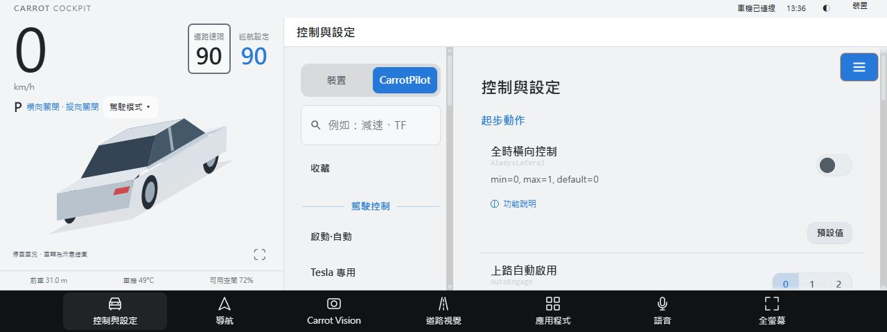

# Carrot Cockpit 繁中 0.3.0

獨立的 Android 座艙版，套件 `me.shind0.carrotweb.tw.cockpit`，可與 CarrotAssist 繁中並存。Android 8.0 以上；原生中文語音需要 Android 12 以上及可用的裝置端語音模型。介面參考中央觸控螢幕的車況／導航分割、底部快捷列與模式卡片，沿用 Carrot 現有功能，車輛及圖示使用本專案原創繪圖，沒有 Tesla 程式、標誌或車輛模型。

[下載 APK](https://github.com/TonyBinheWu/sunnypilot/releases/download/carrot-cockpit-tw-v0.3.0/CarrotCockpit-TW-0.3.0.apk)

先更新並重新啟動 TonyBinheWu/sunnypilot 的 carrot-wip 車機，再讓 Android 裝置與車機連上同一 Wi-Fi／熱點。首次開啟重新選擇裝置；新套件的連線資料、麥克風權限與授權獨立，原版資料不會被匯入或覆寫。尚未支援遠端 FormosaLink 在這個 LAN 版本中直接啟動座艙。

## 0.3.0 全景座艙與車型外觀

操作參考使用者提供的 [Tesla Model Y 設定影片](https://www.youtube.com/watch?v=6bPomDyG3A8) 與深色全景截圖，映射至現有 Carrot 功能，沒有取得或使用 Tesla 專有程式與模型。

- 預設進入全寬 Carrot Vision 座艙視覺，深色道路、左側儀表、右上小地圖、下方胎壓／導航浮動卡片、固定底列；已選用 BEV 的偏好仍保留。小地圖的「放大導航」切至完整導航與最愛，底列可回到 Vision。未收到地圖或胎壓時顯示原因／空值，不產生範例資料。
- 左下車輛控制鍵開啟**獨立重排的控制面板**，再按一次或「×」回到先前的 Vision／導航。左側為控制、輔助駕駛、轉向、車輛、顯示、導航、安全、行車紀錄、聲音、服務、軟體與收藏／裝置；右側使用分類分頁、快捷卡、獨立設定列及大型控制。按「ⓘ」展開完整繁中說明、還原與試聽；「⋯」沿用詳細指南／熱門值／修改歷史入口。原始輸入節點、確認、驗證及回讀保留，搜尋仍使用原有繁中／語音搜尋流程；上游新增的未知設定分類也保留在「其他設定」，不會消失。應用程式抽屜提供行車紀錄、工具／診斷、顯示／字體、導航及裝置更新。
- 「駕駛模式」以靠左浮動卡片選擇原有節能／安全／一般／高速。仍先確認、檢查最新 P 檔／靜止／輔助關閉、寫入並回讀；不會將畫面上的模式名稱當成 Tesla 的車輛控制。
- 右上「顯示」或應用程式 → 顯示／字體，可選淺色／深色／自動。舊日夜偏好會保留；自動依觀看裝置時間07:00–17:59使用淺色，其餘時間深色。字體快捷90／100／125／150／200%沿用既有網頁設定與回讀確認，原有工具設定的80–200%範圍仍可使用。未確認時顯示繁中錯誤且不自動重送。
- 開啟座艙時不要求先啟動鏡頭才可看儀表。座艙外層以自己的新鮮 Compact 車況，透過既有 HUD 呈現介面提供時速、巡航、速限、檔位與控制狀態；不寫入控制或相機狀態，回放時停止送入即時儀表。服務超過1.5秒過期即不再提供，HUD最多2秒清除。相同數值的真正資料更新另有750ms保活，沒有資料時不會靠計時器保活。
- 胎壓卡片顯示車機原生回報值，未確認跨車系單位，故不冒稱為 PSI／kPa。0、非數字、無資料與過期值顯示「—」。結束導航按鈕沿用導航頁原有流程，外部導航須在來源 App 結束；沒有目的地時按鈕停用。

### 本車自動皮膚

網頁與 APK 的立體視覺／BEV，以及座艙停車示意車輛，使用同一套原創輪廓。每30秒最多讀取一次既有 `/api/params_bulk?names=CarName,CarSelected3`，優先用實際辨識的 CarName，無有效值才用手動選車 CarSelected3。**只讀取，不修改車型、不載入參數文字指定的網路模型。** 顯示設定會列出來源車型與所選示意外觀。

| 車系 | 目前外觀 |
| --- | --- |
| Kia EV6 | 低車頂跨界輪廓 |
| Hyundai IONIQ 5 | 方正掀背輪廓 |
| Kia Sorento | 長車身、高車頂休旅輪廓 |
| Tesla Model 3／Model Y | 分別使用轎車／跨界示意輪廓 |
| Toyota RAV4、Honda CR-V、Hyundai Tucson、Kia Sportage | 通用休旅輪廓 |
| 未知或未列車型 | 通用轎車示意，不把未知車型猜成 EV6 |

這些是車系辨識後的**示意皮膚**，不是原廠 CAD、真實車色、精確車身尺寸或 Tesla 感知模型。周圍目標仍按實際辨識類別繪製，不使用本車外觀替代。回放缺少可驗證的記錄車型時使用通用外觀。若要完全一致的特定年式外觀，還需要該車款具有可用授權的3D素材。

0.3.0 APK versionCode4，原套件與簽章延續，請覆蓋安裝；**車機也必須更新 carrot-wip 並重新啟動**。原生頁面檢查 layoutVersion≥3，舊車機會顯示更新提示。原版 CarrotAssist0.2.19保持可下載與獨立更新。桌面瀏覽器／合成資料檢查不等同實體 Android 盒子、CarPlay 接收器或實車驗收。

0.3.0 APK SHA-256：`ae9482a302bdbee0faa28cd9afdb27c0228ee94e599dd47dd590bedd5b76eeb3`，原生建置來源 `7917c0bd857e39957fd01633ff8fe1d1bfd540d0`，CI 44036930047 已確認 v2／v3 簽章及既有簽章憑證。後續控制面板重排與 Google 導航選項由更新車機提供，原生建置輸入未變更。[Google 顯示／搜尋與 Mapbox 路徑設定](../../docs/NAVIGATION_GOOGLE.zh-TW.md)。

0.3.0 驗證：完整網頁測試977項中975通過，2項既有失敗仍為投影浮點數末位及 Vision 測試缺少相依函式；導航／設定／頁面25項 Python 測試通過。寬螢幕1280×480確認功能列底緣等於視窗底緣；390×844檢查搜尋／詳細頁，修正雙列表重疊。隔離資料上將語音播報音量100→101→100，確認回讀及繁中指南。無鏡頭時的儀表在來源逾期後另送明確清除，避免停留在最後速度。以下截圖使用**桌面瀏覽器合成資料**，不是實車或 Android 車載驗收。

## 既有功能與分割畫面

- 左側：目前速度、巡航設定、道路速限、檔位、橫向／縱向控制狀態、模型道路與雷達目標、重要警示、前車距離、車機 CPU 溫度及可用空間。這是車機資訊，不是手機或車輛電池資訊。
- 右側：現有導航地圖；「搜尋目的地／最愛」開啟原有搜尋、命名、編輯、刪除及結束導航功能。沒有金鑰、位置或路線時顯示等待原因，不產生虛構地圖。
- 底部：控制與設定、導航、Carrot Vision、道路視覺放大、應用程式、中文語音及全螢幕。「控制與設定」再次點擊會收回面板並回到先前的 Vision／導航；「應用程式」以浮動抽屜列出行車紀錄、工具／診斷、導航、即時影像、全部設定及裝置更新。設定、重新引導、轉向學習與診斷沿用既有頁面及權限／確認流程。分類、搜尋及數值控制保留，繁中功能說明點開即可展開全文；原有詳細指南、熱門值與修改歷史仍可從設定資訊開啟。
- 「駕駛模式」顯示 Carrot 的節能／安全／一般／高速四種模式，不是 Tesla 的速度設定。此快捷入口只在最新車況為 P 檔、靜止且輔助未啟用時可送出設定，確認後只修改 MyDrivingMode 並重新讀取驗證；不切換實驗模式、不啟用控制、不自動重送。這是入口的 UI 限制，原有設定 API 的規則不變；開啟自動模式時，實際模式仍可能依路況切換。
- 全螢幕隱藏原生標題／IP 及系統列。座艙頁的 Android 返回鍵開啟裝置／App 選單，關閉後回到座艙；「裝置」開啟既有連線、語音模型及字體大小選單。手機直向自動改成上下分割，橫向適合平板及 Android 車機盒子；CarPlay 接收器本身的介面不由 APK 控制。

## 資料與限制

使用既有 Compact WebSocket 解碼器與道路繪圖。車況、模型、雷達及警示各自超過 1.5 秒未更新就清除；切換連線清除舊資料，背景暫停連線及畫面更新。停車時仍能開啟現有 Carrot Vision 的觀看流程；單純開啟座艙不會強制啟動鏡頭或修改控制設定。

雷達未提供物件分類時，目標保持未知標記，不會假裝知道是汽車、行人或機車。獨立的停車／分割示意場景不額外啟動影像物件辨識；預設完整 Vision 場景可使用原有的辨識選項，且仍需有效鏡頭影像。前鏡頭與現有雷達不具備 Tesla 的環車覆蓋、FSD、完整 BEV 感知或高精地圖能力。畫面改版不會提升車輛控制能力，沒有未接入的空調、車鎖、換檔或充電控制按鈕。

APK 由既有受保護簽章建置，使用獨立 carrot-cockpit-tw-updates 更新來源，不能套用原版更新。原版版本與發行檔保持不變。流程會先建立發行草稿，驗證後才公開。

桌面模擬畫面及自動測試與實體 Android／WebView／車機驗證分開；尚未完成實體 Android 盒子、CarPlay 接收器及實車驗收。

## 0.2.0 自適應座艙與操作改造

**先更新並重新啟動 carrot-wip 車機，再覆蓋安裝 0.2.0 APK（versionCode 3）。兩者都需要更新。** 舊的 0.1.x 車機頁面不會因換 APK 自動變成新版操作介面；App 偵測不到新版版面時會顯示繁中更新提示。套件與簽章相同，不必移除或清除設定。

- APK 對已驗證的 `/cockpit` 頁面直接管理沉浸式顯示，隱藏標題／IP、系統列及原生語音浮鈕；不再取決於 Vision 的網頁偏好或先前退出狀態。Android 30 以上另使用系統列控制 API。裝置搜尋、錯誤頁、語音權限與系統設定仍保留原生處理；廠商強制的系統介面不在 App 控制範圍。
- 狀態列、底部列、分割比例與字體偏好共同排版；寬矮螢幕縮短上下列，手機直向改上下分割，窄螢幕底部列可左右滑動。道路視覺填滿車況區，不再塞在數個固定高度區塊中。
- 導航的搜尋／最愛採浮動面板；控制按鈕開合設定面板；次要功能收在應用程式抽屜。沒有新增車輛設定 API，也不改變任何車型、轉向、巡航、權限或停車限制。
- Carrot Vision 使用單一完整工作區，隱藏外層重複車況。座艙內暫時使用既有 Tesla 風格視覺呈現，保留明確選用的 BEV；離開座艙不改寫原版的視覺偏好。「影像工具」可叫出既有控制；開啟頁面不會自動啟動鏡頭。
- 既有辨識結果中的汽車、巴士、卡車、機車、腳踏車及行人使用原創立體輪廓，與座艙自身車輛的外觀一致。模型尺寸、朝向及細節是示意，不是偵測到的真實車型。雷達未分類目標仍為未知標記；不新增感知模型權重、環車攝影機或 Tesla 專有模型。分類物件需要既有 Vision 物件辨識功能及有效影像／校正，單純的外層道路視覺沒有新增分類模型。

306 項相關 JS 測試與 6 項頁面／快取測試通過。全套網頁測試先前的兩項既有失敗仍在（投影浮點數末位、Vision 測試缺少相依函式）；不宣稱全套通過。桌面合成畫面、API 回歸與簽章建置不等於實體 Android 盒子、CarPlay 接收器或實車驗收。

### 物件類別與限制

現有本機 EfficientDet-Lite0 模型的內嵌 labels.txt 已核對，本次擴充其顯示允許類別，並未訓練或新增模型權重。需在既有 Vision 設定明確開啟物件辨識，並有有效前鏡頭影像；預設開關、CPU worker、最多 4Hz 自動降頻、一次一張影像與 1.2 秒過期規則保留，影像不會為此上傳。

| 類別 | 本版實際顯示 |
| --- | --- |
| 汽車、巴士、卡車、機車、腳踏車、行人 | 既有辨識結果，使用原創立體輪廓 |
| 貓、狗、馬、羊、牛、大象、熊、斑馬、長頸鹿 | 新增允許類別；校正／相機資料有效時以近似平地投影定位，尺寸／朝向是示意，不是測量結果 |
| 鳥、交通號誌、STOP 停止標誌 | 影像辨識提示；不產生 3D 位置、距離或燈色。鳥可能飛行，號誌與標誌可能懸空，不能當成接地物件投影 |
| 三角錐、斑馬線 | 更新車機後，可另開「三角錐與斑馬線辨識」；有獨立模型，詳見[道路辨識指南](../carrot_road_models/README.md) |
| 機車停等區、停止線 | **仍無可部署且授權明確的權重，未完成辨識** |

沒有涵蓋所有動物（例如鹿、野豬、蛇不在這個模型類別內），也沒有讀取標誌文字、辨識號誌燈色、將號誌配對車道，或依新增辨識自動煞停。臺灣八角「停」標誌、夜雨與遠小物件的準確度未完成實測。僅靠類別表與合成回歸測試不能證明實際辨識表現。

要支援其餘項目，還需要：

1. 機車停等區、停止線的前向道路語意／實例分割模型；附可散布授權、版本與權重雜湊。三角錐／斑馬線的獨立模型已另行接入，原有 EfficientDet-Lite0 沒有新增這些類別。
2. 臺灣道路標註影像，涵蓋白天、夜晚、雨天、不同道路與距離；額外動物也需相應類別資料。需獨立測試集與每類誤報／漏報、距離及延遲評估。
3. 對應前鏡頭標定及座標驗證；懸空號誌／標誌的可靠深度、追蹤與車道對應。現有近似平地投影無法完成這部分。
4. 實體 Android 盒子與 C3／C4 的效能、溫度及長時間負載驗證。若使用車機推論，須另安排資源，不可擠壓駕駛程序。

APK SHA-256：`b0f34c5720707540801046e91bbf0cefa2d42b9b4b697319fb24a9d88c50b888`。原生建置來源 `8df33f29ad138aaf121b54000b0fab24ef141fa8`，後續分類擴充由更新後的車機網頁提供；APK 原生輸入未變更。請更新到目前 carrot-wip 才能取得全部新版版面及分類顯示。

桌面合成資料示意（不是實車或辨識準確率驗收）：

## 0.1.1 歷史高度修正

修正舊版 Android WebView 不支援 `dvh` 時，底部功能列往上移動、下方留白或超出畫面的問題。網頁加入百分比／`vh` 高度備援；APK 也在已驗證的車機座艙頁套用百分比高度修正，因此即使車機仍使用 0.1.0 時的座艙頁，安裝新版 APK 後重新連線即可套用外框修正。高度隨 WebView 的旋轉、全螢幕及鍵盤縮放重新排版，不快取固定像素；字體比例維持原有偏好。

直接覆蓋安裝 0.1.1（versionCode 2），不需要移除 0.1.0 或清除設定。仍需車機具備 `439fc3d0` 或更新版本的 `/cockpit` 頁面；建議車機一併更新以取得導航頁高度備援。此修正不代表其他舊 WebView 功能皆已支援。

297 項相關 JS 測試通過，包含 APK 相容腳本的頁面範圍／重複載入與網頁高度備援。以本機合成資料及停用 `dvh` 的樣式重現錯誤，驗證新版 APK 相容腳本與網頁備援；不是實體車機或廠商 WebView 驗收。

0.1.1 APK SHA-256：`4e836ff95b6dc342b90c2f998481fc222bcd4819fbe826399ca69ef715bbb812`；原生／網頁修正來源 `b25b88021ab3ee0e92a2bc8952cd28aa0539b4f3`。CI 建置與 v2／v3 簽章驗證通過，憑證與 0.1.0 相同；下載後另核對版本、雜湊、封裝完整性及 APK 內的高度修正腳本。

桌面瀏覽器測試：1280×480、1280×720、1920×720、390×844；不支援 `dvh` 的模擬與既有頁面的 APK 修正均能讓功能列貼齊底部。另檢查 200% 字體與可用高度變化，不將桌面縮放視為實際 Android 軟鍵盤驗收。

## 0.1.0 歷史發行驗證

APK SHA-256：`7497f5fadb1ae76cfdeb403e90bbe6450fc1fd58e7863a83dc290dc3257acd3d`。建置來源 `2bf69134b6450935c7795777e0a41bd2d68d3c66`；確認框與畫面修正由更新後的車機網頁提供。v2／v3 簽章驗證通過，簽章憑證與原版 TW 相同；套件與更新來源仍彼此獨立。Android 盒子需具備更新的 Android System WebView（Chromium 100 以上）；系統版本符合最低要求不代表廠商 WebView 一定支援。

294 項相關網頁／模式操作測試及 6 項頁面／快取測試通過；全套網頁測試有 2 項失敗，已在修改前版本重現（投影浮點數末位差異、Vision 測試缺少相依函式）。瀏覽器已檢查橫向／直向版面及既有功能入口；模式確認操作以隔離的實際產出程式測試，未當作實體 Android 驗收。

車機介面請更新至 `439fc3d0` 或之後的 carrot-wip 並重新啟動。APK 原生建置來源為 `2bf69134`，已核對兩個提交之間的原生程式、資源、座艙 Manifest 與建置腳本完全相同；後續確認框、字體與控制狀態修正由車機網頁提供。
