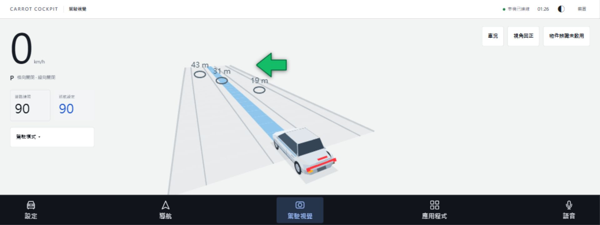
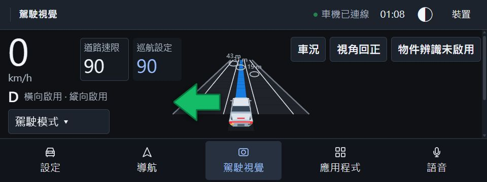
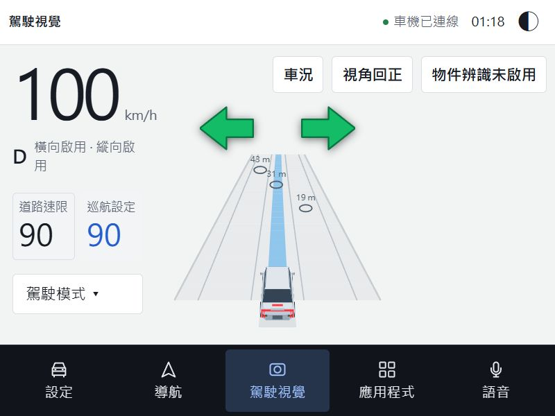

# Carrot Cockpit 0.5.0 驗收紀錄（2026-11-18）

本次完成車機網頁更新及瀏覽器模擬驗收。**沒有可用 Android／車用盒子，因此不代表已完成 APK 在實體車上的端到端驗收。** 12.3 吋以使用者提供的 1920×720 為主要尺寸，並非 16:9；保留 4:3 及較小邏輯尺寸。

## 版面與互動

| 實際 CSS viewport | 字體比例 | 頁面 | 最終結果 |
| --- | --- | --- | --- |
| 1920×720 | 100／125／150／200% | 駕駛視覺、導航、設定、工具、紀錄 | 20 組通過 |
| 960×360（1920×720、Android 密度 2 的模擬） | 100／200% | 同上 | 10 組通過 |
| 800×600（4:3） | 100／200% | 同上 | 10 組通過 |
| 1280×480 | 100／200% | 同上 | 10 組通過 |

共 50 組最終獨立案例，檢查實際尺寸、外層與設定頁橫向溢出、底列貼底、儀表與底列交疊、狀態列越界、設定捲動區至少 80px 及操作欄溢出。另目視檢查截圖。短螢幕修正舊樣式覆蓋並列儀表，以及大字時車速單位與速限重疊的問題。

1920×720、800×600、1280×480 各以 200% 字體實際進出瀏覽器全螢幕；在全螢幕內切換視覺／設定／導航／視覺。使用頁面的 fullscreenchange 實際事件確認，並非只按過按鈕。影片另外完成全螢幕與頁面切換，實際全螢幕尺寸為 1920×1080。所有成功週期的底列位置及溢出檢查通過。測試初期作用中分頁不同造成的拒絕與尺寸不符不列入通過數。

滑鼠實際拖動道路畫面後，角度改為 yaw 54°、pitch 約 35.39°；切換設定／導航返回仍保留角度，方向鍵也可操作。「視角回正」確認回到 0°／25°。低速鏡頭距離收斂至 9，高速至 16；這是顯示投影參數，不是車輛控制距離。暫停資料後保持鏡頭並熄滅過期燈號，恢復資料後重新同步。BEV 保留手動視距，凍結後成功加入一筆 human_unverified 人工點；新拖曳不攔截標註點擊。進階工具遮擋已修正，上方「收起工具」可返回簡潔畫面。

## 本車外觀與燈號

以合成 compact carState 實測 EV6、Sorento、Sportage、Carnival、EV9 能各自載入對應外觀。煞車、左燈、右燈及雙黃燈有獨立狀態，資料過期即清除；左右燈使用車身右正、左負的座標，不從轉彎路徑猜測方向燈，也不從減速猜測煞車燈。

五款 Kia 的車身比例、玻璃、車頂、輪圈、側鏡及尾燈有區別。造型參考 [Kia EV9 設計說明](https://www.kiamedia.com/us/en/media/pressreleases/21059/the-2024-kia-ev9-modern-refinement-and-all-electric-capability)與 [Carnival 設計說明](https://www.kiamedia.com/us/en/media/pressreleases/22580/2025-kia-carnival-elevates-multi-purpose-appeal-with-hybrid-power-updated-design-and-next-gen-tech)，由程式繪製原創示意外觀；**不是原廠儀表資產、實車掃描或精確 CAD**，也未細分所有年式／改款。保留既有其他車型及通用外觀。方向燈以固定節奏呈現啟用狀態，不保證實車燈泡與畫面同相位。

| 車型 | 畫面 |
| --- | --- |
| EV6 | [檢視](screenshots/cockpit-ev6-20261118.jpg) |
| Sorento | [檢視](screenshots/cockpit-sorento-20261118.jpg) |
| Sportage | [檢視](screenshots/cockpit-sportage-20261118.jpg) |
| Carnival | [檢視](screenshots/cockpit-carnival-20261118.jpg) |
| EV9 | [檢視](screenshots/cockpit-ev9-20261118.jpg) |

## 既有功能與辨識

- 執行原有 EfficientDet-Lite0 worker 處理真實行人、車流及機車影片，沒有注入辨識框。最後一次含全螢幕的影片測試有 458 次推論結果，記錄到可定位的行人、機車、汽車；位置及模型機率是示意校正下的結果，不能當精確度評估。切換頁面／進出全螢幕後 worker 持續產生新分類，沒有切回只有未分類圓圈的替代 renderer。
- 原生雷達未分類目標仍以圓圈表示，並非所有物件都必須畫成汽車。沒有 360° 感測覆蓋，也沒有新增停止線／機車停等區辨識模型。
- 繁中「語音播報音量」搜尋、功能說明及完整詳細指南可用；在隔離車況中將 SoundLanguageVolume 100→101→100，實際 API 寫入與回讀均確認，測試後還原。
- 導航最愛新增及改名未產生查詢。點最愛後只有一次模擬一般查詢，country=tw、language=zh-Hant、permanent=false，全形門牌 ７ 轉成 7；選結果前沒有目的地，選取後才啟動，結束後清除。刪除需第二次確認。實際 Mapbox 呼叫為零，不能由此宣稱台灣地址命中率與 Google 相同。
- 模擬通道失去回應時清除過期車況，自動重試；恢復後重新顯示「車機已連線」。沒有重送設定寫入，音量修改只有明確操作的兩筆，最終原值 100%。沒有測試真實 Wi-Fi 切換或 Android 背景生命週期。

## 自動測試與 APK

- 完整網頁：**1011／1011 通過**。修正兩項既有測試環境問題：Python 投影末位浮點差異採既有 1e-9 容差、Vision fixture 載入原有停車判斷函式，沒有修改實際投影或停車守門條件。
- 相關隔離後端：**64 項通過**，包含導航資料驗證、舊最愛相容、停用永久查詢、原子寫入、頁面、診斷與原有設定規格。
- 原生沿用 [0.5.0 建置 CI 44117337061](https://github.com/TonyBinheWu/sunnypilot/actions/runs/44117337061)；該次原生測試及 v2／v3 簽章檢查通過。本次重新核對 ZIP CRC、DEX、package／version、SHA-256 與相同 v2 憑證，**沒有重建或覆蓋已發布 APK**。

0.5.0 APK SHA-256：`d5739ffae92087b8821f3d710bfca6ed39f9884124f268892ffccf93ebdc4941`。

[下載 0.5.0 APK](https://github.com/TonyBinheWu/sunnypilot/releases/download/carrot-cockpit-tw-v0.5.0/CarrotCockpit-TW-0.5.0.apk)。停車時先更新並重新啟動 carrot-wip 車機，再重新開啟 App；已安裝 0.5.0 不需重裝。這是共用車機網頁與後端變更，不會改動車輛控制或 Panda。

原始最終量測：[驗收 JSON](testing/cockpit-acceptance-20261118.json)。尚待實體 Android／車用盒子的觸控、密度、沉浸式、長時間網路切換與真實車況訊號驗收。
