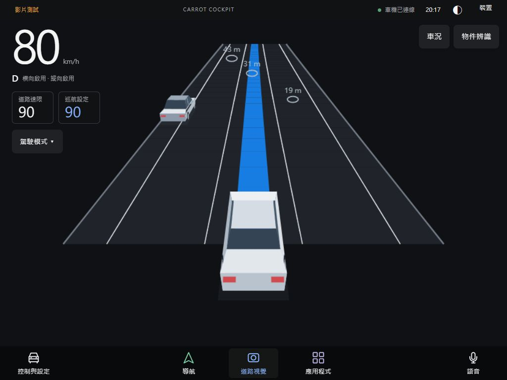
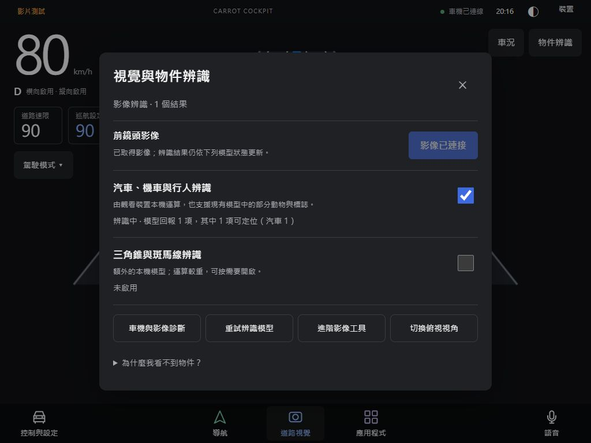
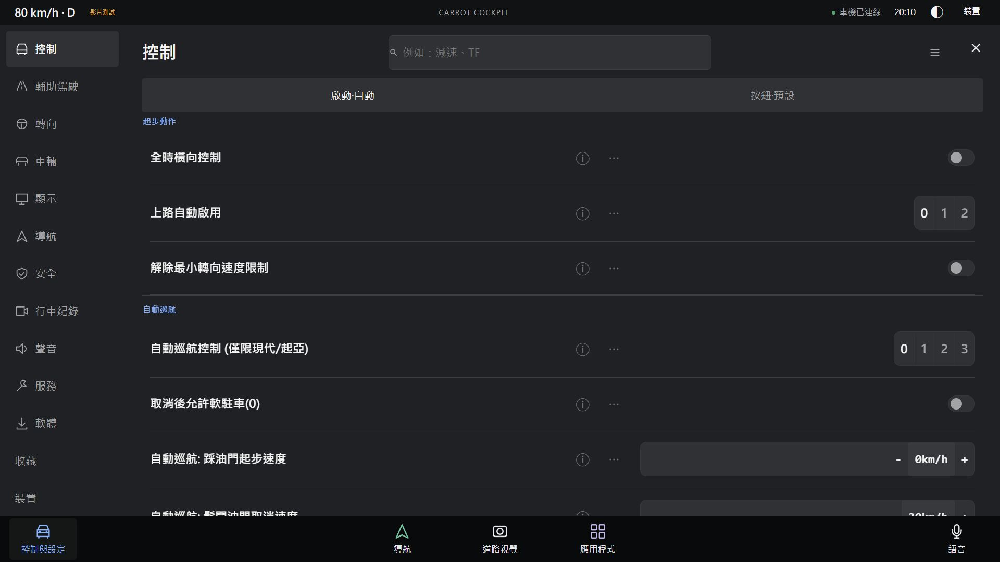

# Carrot Cockpit 影片與螢幕比例驗證

日期：2026-11-17。使用 Cockpit 0.4.0 的完整座艙頁、現有 EfficientDet-Lite0 CPU worker 與實際交通影片；車況、雷達及鏡頭校正使用本機測試資料。使用者已指定先測影片與版面，未連接 Android 實機或車機。

## 結果與修正

- 行人、汽車、機車均從真實影片取得分類輸出，並進入原有的近似地面投影及立體繪圖流程；辨識框有多組不同位置，圖形隨新影格更新。未注入分類結果、替換模型、降低0.5門檻或把未知雷達改成車輛。
- 兩輪設定／導航離開再返回，共4次，均回到完整 Vision，取得非零的新辨識結果；`parentOnly=false`。兩輪實際進出瀏覽器全螢幕，共4次，均等到全螢幕狀態確認後才讀取；影格時間、推論結果數及辨識版本持續增加，返回後仍有可定位分類。
- 一次完整主影片測試記錄573次實際推論結果。一般1920×1080道路畫面的500毫秒取樣中，209次含可定位行人、19次含汽車、154次含機車；這些是取樣點數，不能當成不同物件數量、召回率或準確率。三類並非每一影格都出現，也沒有宣稱三類同一影格穩定同時可定位。
- 第二段 Intel 車流影片另取得16個含可定位汽車的取樣點，並以實際影片第15秒起的片段重現汽車分類與立體圖形。
- 修正舊樣式把設定名稱壓回16px的問題。一般版面設定名稱為17px；足夠大的高解析度螢幕自動使用23px、大型觸控區與88px底列。保留使用者字體比例、繁中搜尋、詳細說明及全部既有控制。
- 視覺設定會列出當下可定位的行人、汽車、機車等分類數量。資料過期、停用或暫停時不繼續列出舊分類；圓圈仍代表未分類的原生雷達參考，可與真正相機分類的立體圖形共存。

## 16:9 與 4:3

12.3吋是實體對角線，網頁依 Android WebView 的實際可用寬高及顯示密度排版。Full HD 使用實體像素作為CSS像素時，會自動放大操作尺寸；若系統回報960×540等邏輯尺寸，沿用原有觸控尺寸。

以下為控制頁實際DOM量測，六種尺寸均無外層／內層橫向溢出，頁面高度等於視窗高度，底列底緣等於視窗底緣。道路頁另外在1280×720、1920×1080及1024×768完成影片觀察。

| 比例 | 可用尺寸 | 設定名稱（100%字體） | 底列高度 | 結果 |
| --- | --- | --- | --- | --- |
| 16:9 | 1920×1080 | 23px | 88px | 通過，自動放大 |
| 16:9 | 1600×900 | 23px | 88px | 通過，自動放大 |
| 16:9 | 1280×720 | 17px | 68px | 通過 |
| 16:9 | 960×540 | 17px | 68px | 通過 |
| 4:3 | 1024×768 | 17px | 68px | 通過 |
| 4:3 | 800×600 | 17px | 68px | 通過 |

4:3低解析度亦曾以150%字體目視檢查內部捲動；本次修正後的預設尺寸量測如上。比例變更不拉伸影片或改變校正數據，辨識仍使用原始影片比例；本車及鄰近物件的3D畫面會依可用畫布重繪。

## 素材與可核對記錄

- [機車、行人與汽車影片](https://github.com/agung-madani/yolov8-motorcycle-counting/blob/b545170c583c2085b015569546c1d7ff2fcaa3b2/gerbanguin.mp4)，SHA-256 `30f57b1600a362086cd64cfc187f1fdd0f8d181320672c72ff674cddc56306d3`。
- [Intel 車流影片](https://github.com/intel-iot-devkit/sample-videos/blob/57978890822836f2b4743852f04f62fc511757e4/person-bicycle-car-detection.mp4)，SHA-256 `452b11b7e0efbd019f1d9570d0c790e90416ad4ad29eec6003872d08443140ef`。影片來源為Intel sample-videos，採CC-BY-4.0；影片未包入APK或本分支。
- [結構化量測與實際結果摘要](testing/cockpit-validation-20261117.json)，包含模型與影片雜湊、四次頁面返回、四次已確認的全螢幕狀態、不同影格及各比例量測。
- 31項相關JS測試通過；完整網頁991項中989通過，另2項仍是既有投影浮點末位與測試缺少`isCarrotVisionParked`。3項HTTP／WebSocket測試通過。回歸測試已包含行人、汽車、機車的分類繪圖、位置更新、過期清除及分類狀態提示。

這些結果驗證桌面瀏覽器內的實際模型、座艙繪圖及互動；尚未驗證實體12.3吋車用盒子的WebView、觸控、DPI、休眠／網路恢復或車機RTC傳輸。測試校正不是影片攝影機的實際標定，畫面距離不代表測量精度。現有辨識逐影格更新，尚非具有穩定跨影格ID的3D追蹤；遠小、遮擋及低分物件仍可能漏辨。

## 更新方式

本次修改位於車機提供的座艙網頁，沒有改動APK原生輸入。停車後更新並重新啟動 `carrot-wip`，再重新開啟Cockpit；APK沿用已驗證簽章的[0.4.0](https://github.com/TonyBinheWu/sunnypilot/releases/download/carrot-cockpit-tw-v0.4.0/CarrotCockpit-TW-0.4.0.apk)，不需移除App或清除設定。

