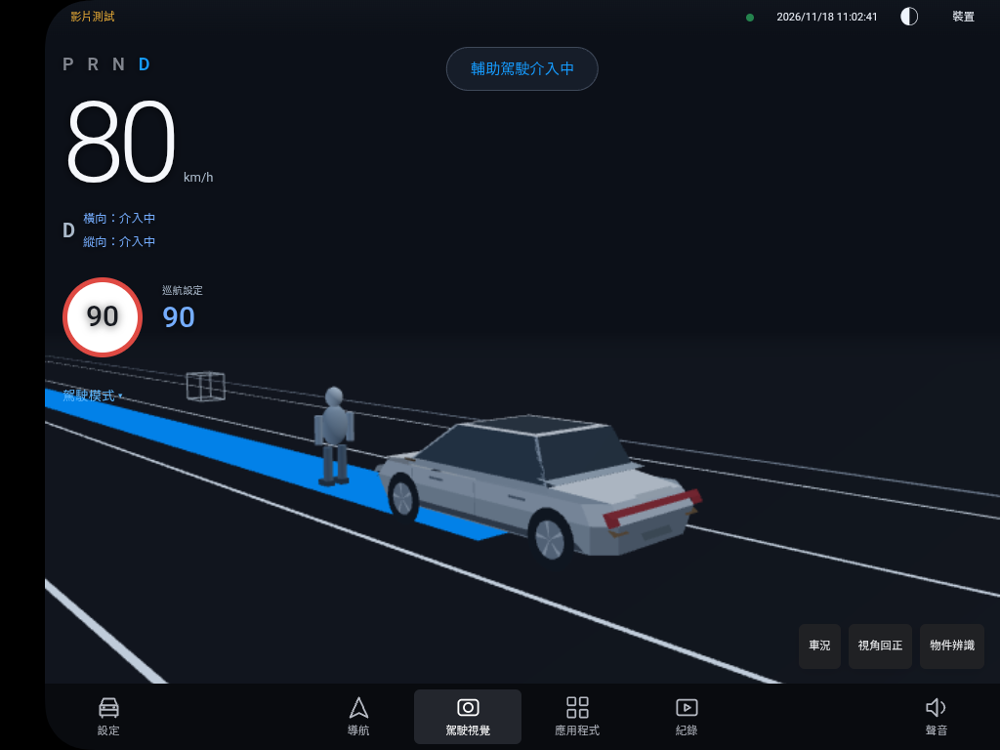
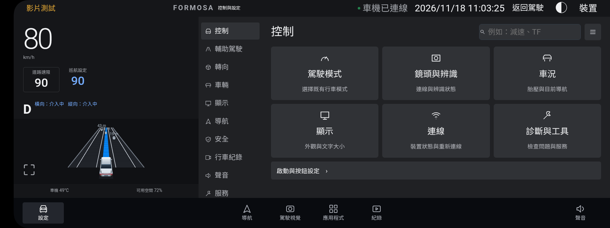
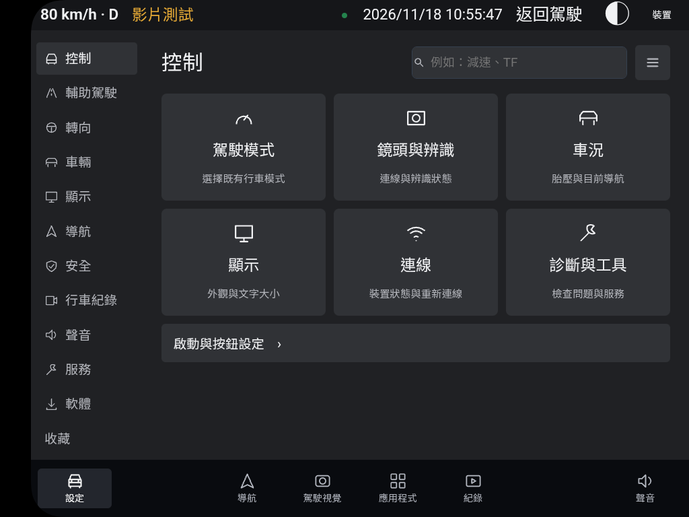

# Formosa 座艙 0.6.0 驗收

2026-11-18。套件仍為 `me.shind0.carrotweb.tw.cockpit`；顯示名稱改為 **Formosa 座艙**，使用獨立藍色圖示。APK 0.6.0／versionCode 8 覆蓋安裝保留資料，原 CarrotAssist 不變。APK 原生來源為 `7a837f66fd7b77f2c9cd9d1b8898c20ea73d3d97`，搭配本次更新後的 `carrot-wip` 網頁；只安裝 APK 不會更新車機網頁。

## 已完成的檢查

- 實體 Samsung SM-A146P、Android 14、USB ADB：安裝同簽章 APK 成功，驗證名稱、更新對話框及座艙麥克風權限移除。Android 返回鍵可回到主畫面，日期時間以台灣時區持續更新。
- 暫時覆寫 Android 顯示尺寸為 **1920×720** 與 **1024×768（4:3）**，檢查駕駛、設定、應用程式、全螢幕及 100%／200% 字級。手機瀏海會占用部分寬度，因此網頁可用寬度分別為 1877／978。這是實體手機上的顯示尺寸模擬，並非 12.3 吋車機的觸控驗收。
- 4:3 設定區改為完整寬度，避免左側車況占去大半操作區；寬畫面保留車況。底列按鈕各有獨立格位，大字標籤不互相覆蓋。道路畫布覆蓋整個可用視窗，浮動儀表及底列位於上層。
- 隔離合成車況驗證橫向單獨介入、縱向單獨介入、兩者介入、兩者未介入及資料過期。顯示取自各自新鮮 `carControl` 旗標，資料中斷變成「無資料」，不以總開關猜測。
- 手機實際啟用 **WebGL 2**。原辨識 worker／固定 EfficientDet-Lite0 模型處理公開真實影片，未注入分類答案；車況與校正為測試資料。汽車、行人、機車與腳踏車的定位分類會隨影片更新；未分類原生雷達保留中性立體框，沒有冒充汽車。
- 單一 3D 場景整合分類模型、路徑及本車。各種靜態模型合併幾何後重用，避免每個肢體／輪圈增加一個繪圖呼叫；路面使用固定容量 GPU 緩衝區。既有解析度選項、模型逾期、單一推論在途與負載退讓規則維持。
- 回歸測試包含 3D 模型有限值、左右座標、4:3／16:9／1920×720 本車位置、近端道路延伸、移動物件、過期清除、縮放、繪圖 context 遺失／恢復與備援。車型、煞車／方向燈、原有 BEV、導航、搜尋與設定測試均保留。

完整網頁 **1,022／1,022**、頁面 HTTP **2／2** 通過。[去識別的量測 JSON](testing/formosa-0.6.0-android.json)包含獨立橫縱向、實體 Android 版面、分類結果及 context 恢復狀態。分類次數是重複取樣，不是物件總數或準確率。

## 實際能力與限制

這是現有資料的 3D 呈現，不是 Tesla FSD、環車感知或高精地圖。模型尺寸、外觀和朝向為示意；原先的地面投影位置也不等於精確三維量測。攝影機幀與合成校正測試不能代表真實車輛距離精度。

號誌、STOP、鳥類和斑馬線的影像結果若無可靠位置，僅以立體觀測圖示顯示並標示未定位；不推測號誌燈色，不把斑馬線框變成虛構道路輪廓。停止線、機車停等區尚無辨識模型。沒有生成周圍建築、樹木、天氣、電量或不存在的物件。原創車型外觀並非廠商 CAD。

影片分類並非每幀都存在：信心不足、離開畫面、校正不足或超過 1.2 秒即清除，不以凍結舊物件維持畫面。CPU 負載與各裝置 WebView／GPU 仍會影響頻率；本次沒有真實 RTC、實車行駛、長時間車用盒子熱測或道路安全驗收，也未連線或修改實車控制參數。

## APK 核對

[CI 44223147163](https://github.com/TonyBinheWu/sunnypilot/actions/runs/44223147163) 建置及 v2／v3 簽章驗證成功。另核對 ZIP CRC、套件／版本／原生版面檢查、SHA-256 與既有 v2 憑證一致；手機以 `adb install -r` 安裝同一個 APK。

SHA-256：`e69e32d465f27564f0d23e58f30c72a04bdee407072c3651072119133387f8fc`。

[下載 0.6.0](https://github.com/TonyBinheWu/sunnypilot/releases/download/carrot-cockpit-tw-v0.6.0/CarrotCockpit-TW-0.6.0.apk)。舊版已公開 APK 保持不變；更新頻道延用原座艙識別，避免誤裝成標準版。
