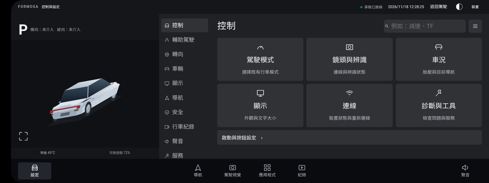
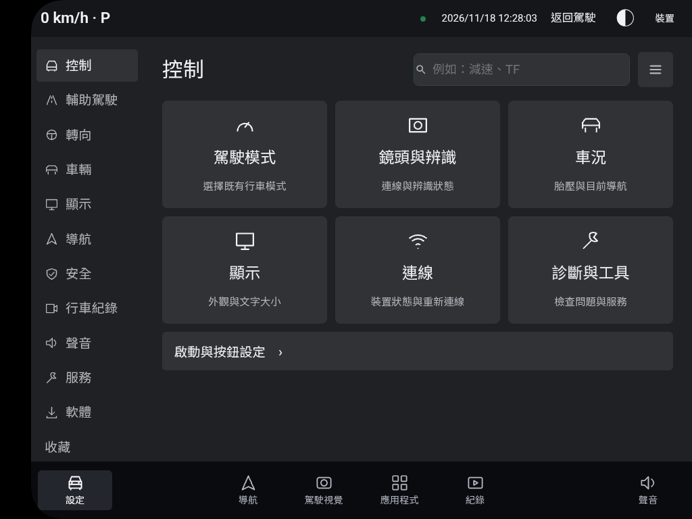
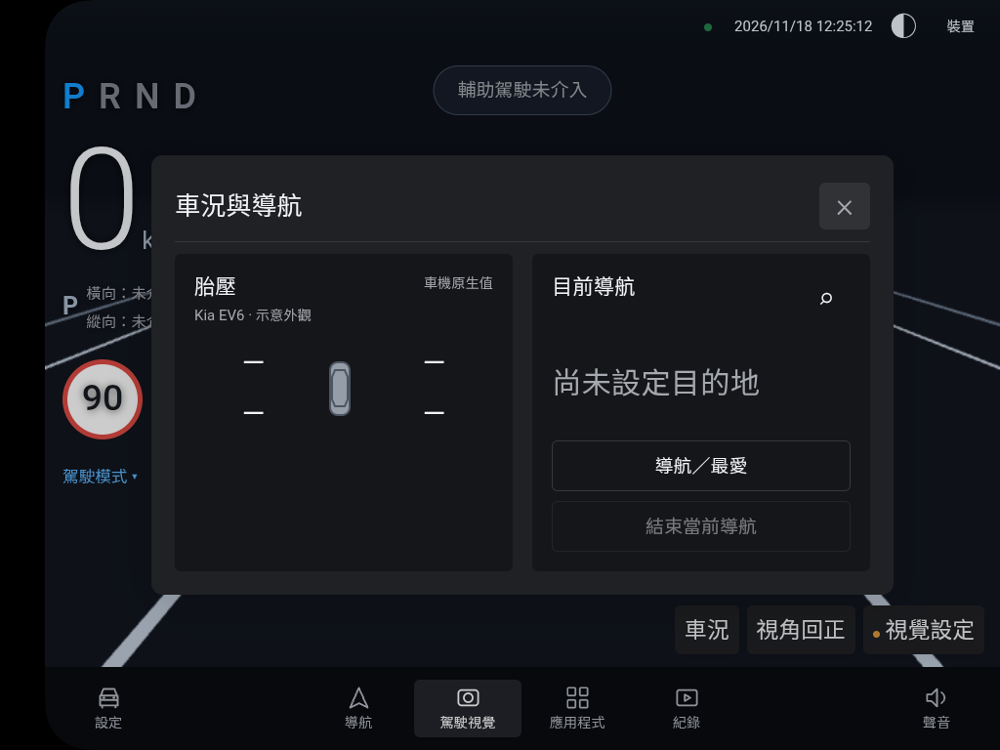
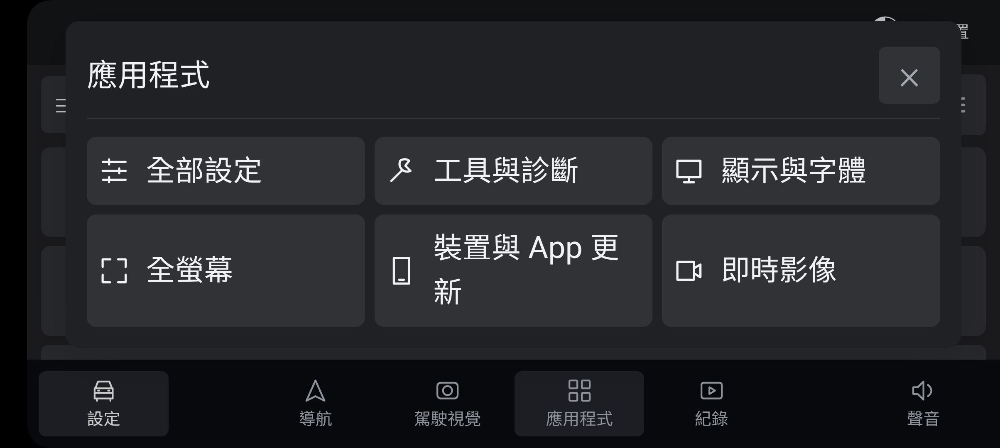
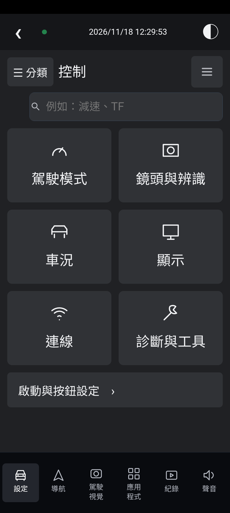

# Formosa 座艙介面檢查與修正（2026-11-18）

## 0.6.2 操作檢視

| 操作 | 修正後的行為 |
|---|---|
| 看道路、開始或結束導航 | 寬螢幕預設把工作區留給駕駛視覺。選定目的地或車機回報有新鮮的導航地圖時展開雙欄。結束後收回空間。「導航」隨時可以手動開啟地圖與最愛。 |
| 找常用功能 | 「應用」分成「駕駛與導航」、「視覺與聲音」、「設定與裝置」。同一路徑的駕駛視覺捷徑合併。鏡頭連線、辨識狀態及重試集中在「鏡頭與物件辨識」。 |
| 從子選單返回 | 車況、駕駛模式、鏡頭辨識和顯示設定會記住進入位置。從「應用」開啟時，關閉或按返回會回到剛才的按鈕與捲動位置。選擇另一個頁面會直接前往該頁。 |
| 查看連線、開啟聲音 | 小螢幕上的勾號表示已連線，省略號表示等待，迴轉箭頭表示重連中。點圖示可讀取說明。剛啟動時按聲音，也會在設定載入後開啟聲音分類。 |
| 第一次連車機 | 裝置列表與說明可一起捲動，搜尋和手動輸入仍可操作。輸入格式錯誤時保留內容並顯示欄位提示，可用鍵盤完成鍵提交。 |

### 驗證結果

使用實際座艙網頁、APK 的視窗相容程式及隔離的模擬車況。每種尺寸均測試 100% 與 200% 字體，涵蓋 1920 × 720 超寬車機、1280 × 720（16:9）、1024 × 768（4:3）、390 × 844 直向手機、844 × 390 橫向手機及 960 × 360 短視窗。驗證項目包含導航啟停、設定與行車紀錄切換、子選單返回、聲音入口、進出全螢幕及功能列定位。另測同一頁從直向旋轉至橫向時保留繁中搜尋結果，以及車況資料中斷後恢復。

在 1920 × 720、200% 大字下，未導航的駕駛視覺由 1,019 px 增至 1,758 px。4:3 同條件由 518 px 增至 900 px。網頁測試通過 1,095 項。Android 建置驗證了套件、版本與簽署。本次 ADB 裝置清單為空，原生輸入法、實體面板亮度與觸感仍待 Android 真機確認。

## 0.6.0 介面檢視紀錄

本輪檢查座艙的駕駛畫面、控制與設定、車況、導航、應用程式、返回操作與載入／連線提示。以固定資訊位置、清楚的操作層級、可辨識的目前狀態及足夠的觸控空間為原則，參考 [Tesla 官方中央觸控螢幕操作說明](https://www.tesla.com/ownersmanual/modely/en_us/GUID-518C51C1-E9AC-4A68-AE12-07F4FF8C881E.html)，沿用本專案原創外觀及既有功能。

## 已修正的問題

| 範圍 | 問題與修正後的行為 |
|---|---|
| 頂部狀態列 | 舊媒體樣式會再次放大時間與外觀按鈕，造成裁切。統一有上限的介面字級、行高及至少 44 px 的主要按鈕高度；日期與秒數繼續即時更新。 |
| 設定空間 | Android 工具列占用高度後，部分 4:3 視窗會誤用左右分割。可用寬度不超過 1100 CSS px 時，設定、工具、紀錄使用完整寬度；更寬的螢幕保留車況預覽。 |
| 車況卡片 | 大字模式的車型說明擠在胎壓標題旁，胎壓上下兩列距離不足。分開標題與車型說明，調整列高，導航按鈕與回應文字使用清楚的介面字級。 |
| 彈窗 | 改為同一列的標題與關閉鍵，捲動時固定在上方；關閉圖示隨介面字級縮放，避免超出按鈕。保留原本的確認、取消與表單處理。 |
| 返回 | 先處理目前彈窗，再處理設定分類抽屜、設定詳細頁或搜尋結果，最後回到駕駛／導航主畫面。原有操作尚在處理時，尊重原本的取消限制；返回不會代按確認。 |
| 初次引導 | 引導出現時，外框同步切到設定版面，避免駕駛儀表蓋在引導內容上。 |
| 載入失敗 | 功能頁等候逾時、載入失敗或分類讀取失敗時提供明確重試入口，不再只顯示等待或要求重開整個 App。重試頁面及分類不會自動重送修改。 |
| 既有導航 | 開啟頁面先讀取目前目的地；開啟車況或導航時再確認，導航頁可見時定期同步。這些是車機本機狀態查詢，不會呼叫付費地址搜尋。 |
| 結束導航 | 車況卡片直接等待真正的成功／失敗回應。讀取或修改中暫停重複操作，忽略較舊讀取結果；回應遺失時顯示未確認，改由「重新讀取導航狀態」查證，不自動重送結束要求。導航 API 請求最多等候 10 秒。 |
| 全螢幕 | 「全螢幕／離開全螢幕」名稱與按鈕狀態跟隨實際瀏覽器全螢幕狀態。 |
| 駕駛模式 | 等待使用者確認期間，若離開有效停車條件或車況過期，立即收起確認區並告知已取消，不送出模式設定。 |
| 視覺辨識 | 駕駛畫面固定使用「視覺設定」入口，避免不同錯誤文字讓工具列反覆變寬；提醒圓點、完整狀態及原因仍保留。 |
| 連線與字體 | 已接通通道但尚無新鮮車況時使用等待提示色。字體選單顯示實際讀值，尚未讀取時不假裝已選 100%。數值操作補上「上一個值／下一個值」繁中標籤。 |

## 已保留的功能

滿版 3D、分類物件與未分類目標、BEV、車速縮放、拖曳視角、車型示意外觀及燈號保持原有資料與繪圖流程。導航最愛、繁中搜尋、詳細指南、設定收藏／歷史／還原、行車紀錄、工具與診斷入口保留。沒有加入無資料來源的車況、環車物件或額外車輛控制能力。

橫向與縱向仍各自依新鮮的控制資料顯示；本輪未修改轉向、縱向控制、Panda 保護、車型參數或設定數值的含義。原 CarrotAssist 的語音功能不受影響。

## 驗證與限制

完整網頁測試 **1,038 項通過**；座艙頁面／快取測試 **2 項通過**。包含逾時後重試、首次引導版面、返回層級、取消操作、延遲讀取、遺失修改回應及避免重送的回歸測試。

Samsung SM-A146P／Android 14／0.6.0 APK 經 USB ADB 實測，使用隔離的合成車況及記憶體導航資料：

| 畫面 | 本次保存的驗證 |
|---|---|
| 1920×720 顯示覆寫 | 可用 CSS 視窗約 1877×720，200% 字體、設定切換、頂列與固定底列。 |
| 1024×768（4:3）顯示覆寫 | 可用 CSS 視窗約 978×768，200% 字體、完整寬度設定、車況卡片、全螢幕與返回。 |
| 手機直向 | 約 380×825 CSS px，100%／200% 字體與設定操作。 |
| 手機橫向 | 約 825×380 CSS px，200% 字體、長彈窗捲動、固定標題與關閉鍵。 |

保存的量測中，沒有外框或嵌入頁水平溢出；底列貼齊可用視窗底部，標籤及頂列項目都在各自容器內。實測還確認既有目的地讀取、結束導航的實際回應、行駛時取消待確認模式，以及原生返回。沒有寫入實車設定，也沒有呼叫真實地圖／地理編碼服務。

這是同一台 Android 手機與顯示覆寫的驗證，尚不等於實體 12.3 吋車用盒子、所有 WebView 品牌版本、真實 RTC 影像、地圖準確度或長時間實車驗收。分類模型的既有限制見 [0.6.0 驗收說明](FORMOSA_COCKPIT_0.6.0_ACCEPTANCE.zh-TW.md)。[本輪量測與結果](testing/formosa-interface-audit-20261118.json)。

## 如何取得修正

更新並重新啟動 `carrot-wip` 車機，再關閉並重新開啟 Formosa 座艙。這些修正由車機提供的座艙網頁載入，**現有 0.6.0 APK 可以沿用**，不需要清除資料；既有公開 APK、簽章、版本及下載連結不變。

