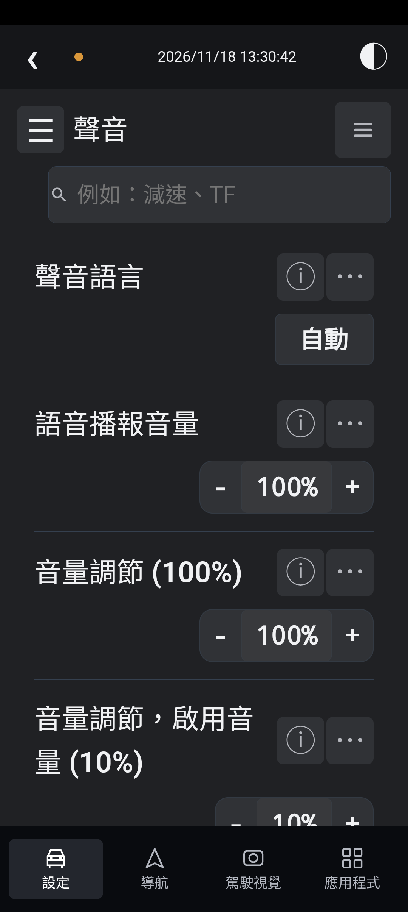
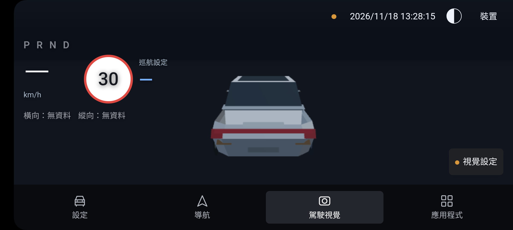
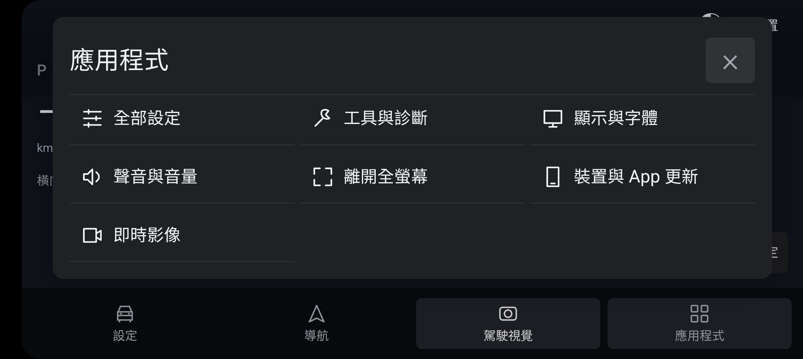
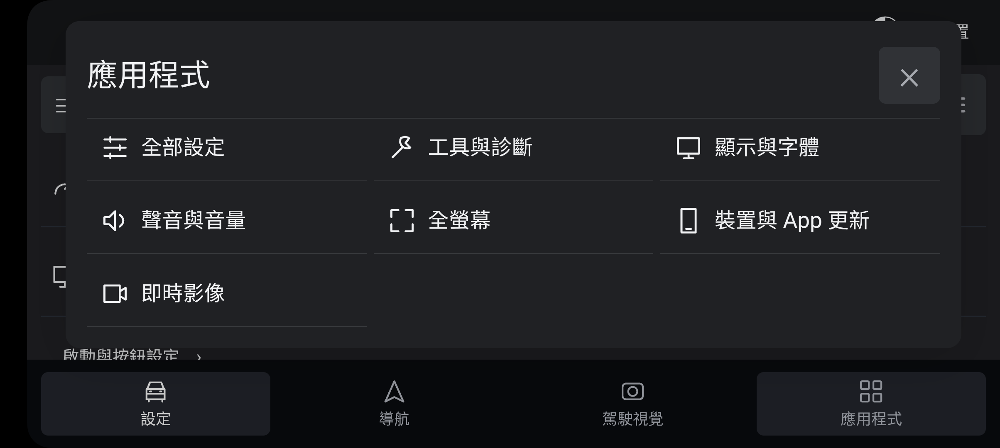

# Formosa 座艙：實車連線與手機版面實測

2026-11-18，使用實際 Samsung SM-A146P／Android 14，透過 USB ADB 操作既有 **Formosa 座艙 0.6.0／code 8**，連線到停車、非行車狀態的 `carrot-wip` 車機。此次 UI 最終修正版本為 `58e81ee8`，座艙版面版本為 9。APK 沿用原簽章及套件，介面由更新後的車機提供，不需要另裝同名 APK。

## 手機擁擠問題與修正

- 手機底列保留設定、導航、駕駛視覺、應用程式四個主要入口；紀錄、聲音、車況、模式、診斷、裝置更新及全螢幕仍在應用程式內。
- 直向控制首頁改為圖示、標題及簡短說明的單欄清單，短橫向應用程式改為較低的操作列。
- 修正共用字體處理重複放大設定文字的問題：200% 模式下，手機參數標題由錯誤的 54 CSS px 修正為有上限的 27 CSS px。詳細說明仍保留放大能力。
- 保留速度、道路速限、巡航設定及獨立橫向／縱向狀態，收起重複狀態與浮動捷徑；視角回正移到視覺設定。寬車載螢幕沿用原有分區。

## 實際手機操作結果

| 項目 | 本次觀察 |
|---|---|
| 真實車機介面 | 拉取分支更新後，逐位元組核對車機的座艙 JS、手機 CSS 及控制 CSS 與本機一致 |
| 字體 | 100% 與 200% 實際套用；200% 設定標題、數值及說明按鈕可分開閱讀與操作 |
| 直向／橫向 | 使用手機原顯示尺寸旋轉，設定採完整寬度，駕駛畫面及底列保持在可用範圍 |
| 頁面切換 | 設定、導航、駕駛視覺、應用程式往返；聲音捷徑可進入原參數頁 |
| 搜尋與詳細內容 | 實際輸入 `SoundLanguageVolume`，顯示繁中「語音播報音量」結果；開啟詳細內容，再以 Android 返回鍵回到清單；分類抽屜亦可關閉 |
| 全螢幕 | 開啟後重新進入應用程式可見「離開全螢幕」；切換設定與駕駛視覺後再離開，標籤恢復「全螢幕」；旋轉回直向仍可操作 |
| 停車資料狀態 | 當時沒有即時橫向／縱向控制資料，兩者顯示「無資料」；未把停車畫面當成行車啟用證據 |
| 還原 | 字體恢復原本 90%；手機自動旋轉恢復開啟、旋轉值 0；原 1080×2408 顯示尺寸及原 density override 454 保留 |
| 車輛設定 | 未操作駕駛參數；測前後比對 `CustomSteerMax`、`MyDrivingMode`、`SoundLanguageVolume`、`SoundVolumeAdjust` 相同，車機仍為 offroad |

實際搜尋使用參數英文鍵名，確認繁中結果與內容；本次沒有透過 ADB 輸入中文查詢。沒有送出導航目的地、付費地圖查詢或駕駛控制指令。

## 車載尺寸預覽與軟體檢查

Codex 旁邊的互動預覽載入同一套座艙程式，使用隔離的模擬車況，**不連接實車**。可選 12.3 吋 **1920×720**、16:9 **1280×720**、4:3 **1024×768**、手機直向 **380×825** 與手機橫向 **825×380**，並切換 100%～200% 字體、設定、導航及駕駛視覺。預覽縮放至視窗時保持所選版面的實際比例，也可選 1:1 像素。

上述五組外層視窗在 200% 量測均沒有水平溢出；另針對手機參數標題確認 27 CSS px。這是視窗／版面量測，不能視為所有內頁的逐項實機驗收。完整網頁測試 **1,039 項通過**，隔離 HTTP 頁面測試 **2 項通過**。[結構化結果](testing/formosa-live-20261118.json)。

尚未完成實體 12.3 吋車用盒子、長時間連線、行駛中偵測／物件距離、WebRTC 鏡頭或控制功能的驗收；本次停車 UI 測試不改變既有模型能力及限制。

## 手機截圖

