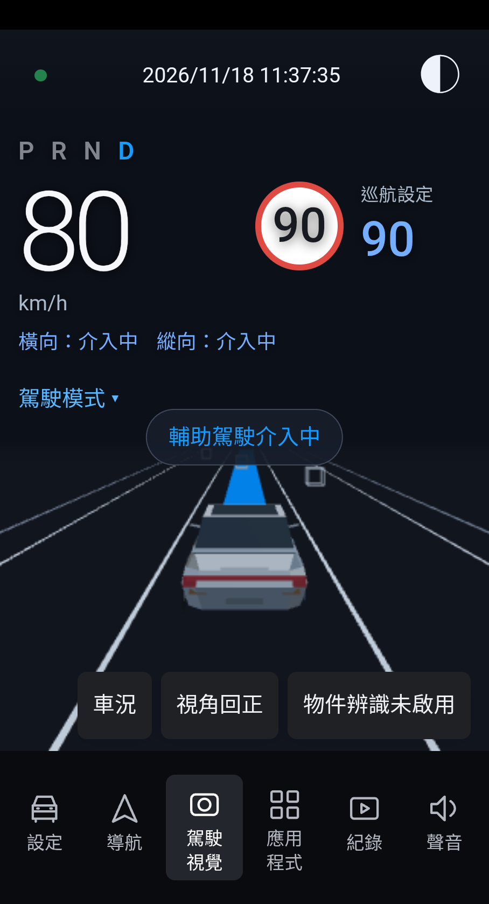
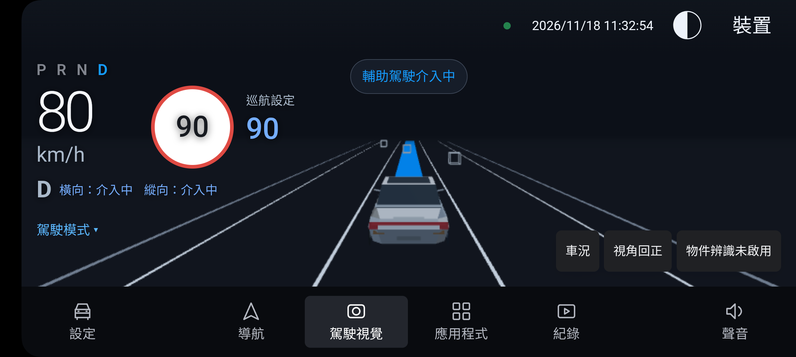
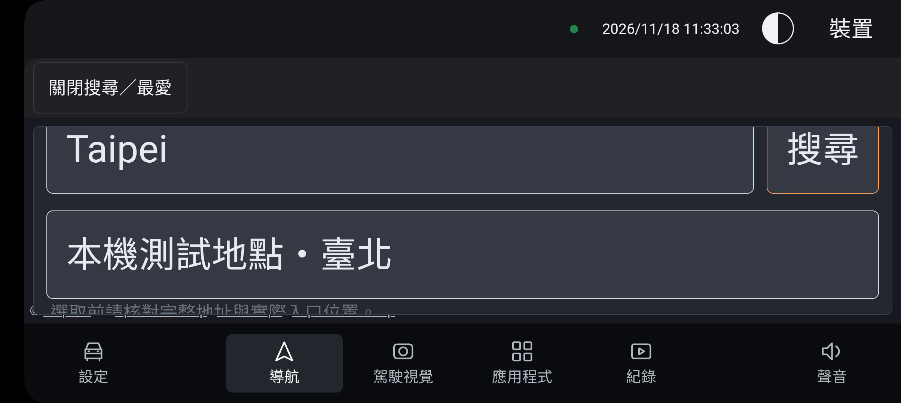

# 使用安卓手機作為主要觀看畫面

Formosa 座艙 0.6.0 APK 可使用手機直向或橫向觀看，Android 8.0 以上。先更新並重新啟動 `carrot-wip` 車機，再重新開啟 App，手機版面會自動套用；本次不變更 APK、套件或既有資料。網頁 `/cockpit` 使用同一套手機版面。

## 操作方式

1. 手機與車機連到同一個 Wi-Fi／熱點，在 App 選擇車機。要自動切換直向／橫向，請開啟 Android 的「自動旋轉」。
2. 「駕駛視覺」使用滿版 3D 場景。直向將檔位、速度、速限與巡航設定排在上方，橫向使用較精簡的儀表配置；3D 視角依螢幕比例調整，避免本車被裁掉。
3. 底列保留設定、導航、駕駛視覺、應用程式、紀錄與聲音。小尺寸的四字標籤分成兩行，觸控按鈕維持獨立範圍。工具、診斷、裝置更新與全螢幕可從「應用程式」開啟；面板可向下捲動。
4. 設定、工具、紀錄及導航在手機上使用完整寬度。「分類」開啟設定分類，選擇後收起；參數名稱與操作區上下排列，長名稱換行。「ⓘ」保留說明，「⋯」保留原詳細指南及其他操作。
5. 從頂部顯示按鈕或「應用程式 → 顯示與字體」調整字體。主要內容可放大至 200%，頂列、底列與標頭採有限放大以保留操作空間。頂部持續顯示台灣日期、時間及秒數。
6. 導航的搜尋按鈕有獨立位置，不蓋住輸入欄。開啟搜尋才喚起鍵盤；按「關閉搜尋／最愛」或 Android 返回鍵可關閉搜尋。鍵盤顯示時，Android 可能先用一次返回鍵收起鍵盤。切換到其他頁面也會收起搜尋並解除輸入焦點。

直向駕駛畫面不常駐小地圖，以保留儀表與道路空間；既有導航及有路線時的放大導航入口保留。手機的瀏海、狀態區及鍵盤會改變可用視窗，版面跟隨可用區域調整。

## 畫質與保留功能

直向的低／自動／高畫質分別使用約 480／960／1920 的長邊預算，並維持比例及既有倍率上限；不再套用橫向 540 高度上限，避免直向影像過度縮小。橫向及寬螢幕畫質預算不變。低規裝置可選較低畫質，減少繪圖負擔。

保留拖曳視角、車速縮放、視角回正、車型外觀、實際燈號、分類物件、BEV、繁中搜尋與既有確認／回讀流程。手機版面不會增加辨識類別、環車感測或控制權限；模型與位置的限制仍見 [0.6.0 驗收](FORMOSA_COCKPIT_0.6.0_ACCEPTANCE.zh-TW.md)。

## 驗證範圍

2026-11-18，在 Samsung SM-A146P／Android 14／0.6.0 APK 透過 USB ADB 實測：原手機直向約 380×825、橫向約 825×380 CSS px，另在同一手機暫時覆寫顯示尺寸，驗證約 320×572 的小尺寸版面。測試 100%／200% 字級、設定分類、長標題、應用功能捲動、導航鍵盤／假搜尋結果、返回與旋轉。使用隔離的合成車況及本機假搜尋服務，未寫入實車設定、未查詢真實地圖 API。

另以幾何回歸測試檢查 320×568 至 480×800 的五款 Kia 示意模型在近／遠視角的完整顯示，以及直向／橫向解析度預算一致性。完整網頁 **1,026 項通過**，隔離頁面 HTTP **2 項通過**。這不是所有 Android 品牌、版本或長時間車用環境的驗收。

[版面量測紀錄](testing/formosa-phone-20261118.json)。

